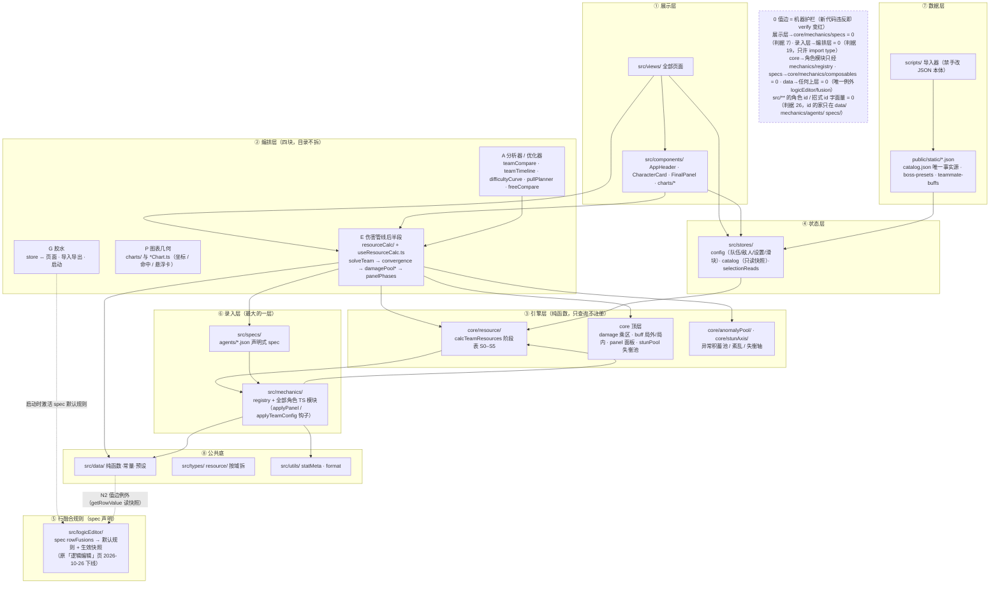
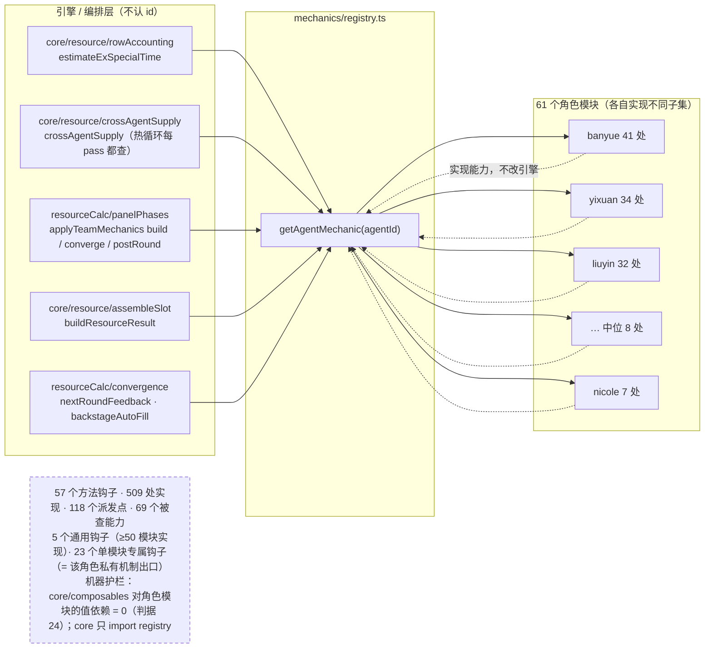
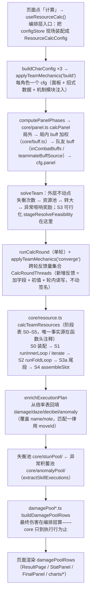
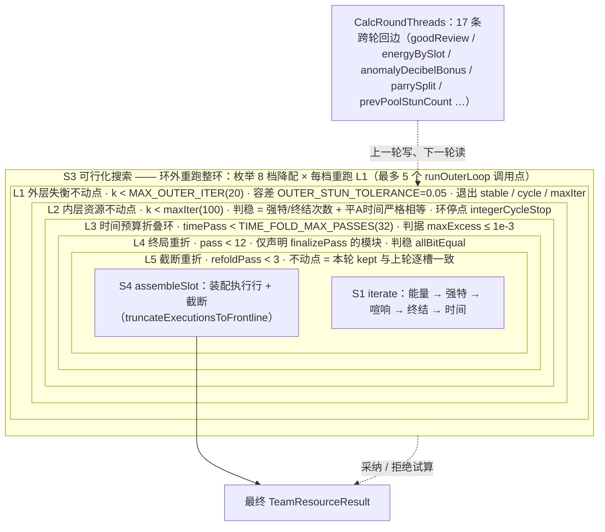

# 代码架构地图（AI 导航用）

> 本文不是代码百科全书——只回答一个问题：**"我拿到一个任务，该读哪些文件？"**
> 细节（乘区公式、钩子语义、口径）在代码注释与测试里，文档不重复。
> 配套阅读：`ENGINE_PIPELINE_GUIDE.md`（一轮计算的数据流/钩子/坑）、`AGENT_RECORDING_SOP.md`（角色录入）。
> 阅读顺序建议：本文（地图）→ ENGINE_PIPELINE_GUIDE（管线）→ 按任务进对应层。

## 0. 心智模型：八层 + 单向依赖

**层与层之间不是「上一层调用下一层」这么简单**：引擎与 61 个角色模块之间是**多对多**——
模块声明能力，引擎按能力查询（`getAgentMechanic(id)?.<能力>`），不认 id：

**带实测文件数 / 行数 / 值边条数的图版**：`docs/architecture-layers.svg`（浏览器直接开）。
数字由 `node scripts/gen-architecture-diagrams.mjs` 现场测量生成并随 HEAD 自动对时——**别手抄数字进本文**（抄了就静默过期）。

依赖方向：展示 → 编排 → 引擎；录入层被编排/引擎经 registry 消费；数据层被状态层加载。
（编排层目录**不按四块拆分**：挪约 60 个文件的 import、行为零变化；「管线后半段并入 core」的前提：① **store 依赖已清零**（CC-245：resourceCalc/ 从不调用 useXStore，store 实例由 useResourceCalc 注入；运行时闭包进入 stores/ 只剩纯函数 selectionReads，锁 `resourceCalcStoreDeps.test`）；② 仍未满足：运行时闭包依赖 mechanics 注册表与全部角色模块、`logicEditor/fusion`（经 data/moveTableQueries 的全局快照）——core 禁止依赖这两者（原第三项 `composables/agentMechanicView` 已由 CC-246 消除：AUTO_AXIS_PRESET_HINTS 迁入 mechanics/registry，锁同上），并入须改注入。不在 R6 内开（清点见 docs/mcp-r6-refactor-list.md §8 第 266 行）。决定见 docs/mcp-r6-refactor-list.md §5。）
**引擎只查询、不注册**：`src/core/**` 取角色模块只许 `import { getAgentMechanic } from '@/mechanics/registry'`，不许按值 import `@/mechanics`（index，会加载并注册全部角色模块，而角色模块又 import core ⇒ 环）；注册副作用只在入口：浏览器 `src/main.ts` 的 `import '@/mechanics'`，测试 `vite.config.ts` `test.setupFiles`。新增运行入口（Worker / node 脚本）必须自己 import `@/mechanics`。守卫：`src/core/__tests__/coreMechanicsRegistryOnly.test.ts`（R6 C1，第 139 轮）。
**录入层对编排层只许 `import type`**（值边必成环：R35 实测 `claret → resourceCalc/helpers → mechanics/index → claret`）；
录入层要用编排层的纯函数一律**下沉 `src/data/`**（`data/moveTableQueries.ts` 先例——招式查找 / 行值 / 融合行值 / 平A 第 3 段；
`src/data/` 是各层都可依赖的公共底），导入方同批改到 `src/data/`，原位置不留转出壳（非入口文件转出即红，`scripts/lib/dead-channel-ls.mjs#REEXPORT_ENTRY_FILES`）。机器面 = 判据 19 `layer-inversion`
（`scripts/lib/layer-inversion.mjs` 头注释是口径唯一事实源：值导入 0 + 反空洞下限 + `claret.ts` 形状锁）。
**新 AI 读代码的捷径：从上往下读一遍调用链（页面 → useResourceCalc → core），每个文件头注释就是它的职责声明。**

**分层规则 → 锁**（CC-248 汇总；每条口头规则都有对应的机器锁，新写代码违反时 verify 变红。闭包锁共用 `src/test/importClosure.ts#runtimeImportOffenders`，只计值 import，跳过 `import type`）：

| 规则 | 口径 | 锁 |
|---|---|---|
| core 取角色模块只经 registry | 直接 import | `src/core/__tests__/coreMechanicsRegistryOnly.test.ts` |
| core 纯函数层：闭包不进入 specs / logicEditor / composables / stores / 展示层；mechanics/registry 是纯叶子 | 传递闭包 | `src/core/__tests__/coreRuntimeDeps.test.ts` |
| 管线后半段 resourceCalc 不进入 stores（selectionReads 除外）和上层 composables | 传递闭包 | `src/composables/__tests__/resourceCalcStoreDeps.test.ts` |
| specs 不进入 core / mechanics / composables / stores / 展示层（只白名单 logicEditor/fusion，经 data 带入） | 传递闭包 | `src/specs/__tests__/specsRuntimeDeps.test.ts` |
| data 是公共底：不进入任何上层（只白名单 logicEditor/fusion，N2 裁决） | 传递闭包 | `src/data/__tests__/dataRuntimeDeps.test.ts` |
| 展示层（views / components）不值导入 core / mechanics / specs | 直接 import | check-guards 判据 7 `detectExhibitionLayerImport` |
| 录入层（mechanics / specs）对编排层只许 import type | 直接 import | check-guards 判据 19 `scripts/lib/layer-inversion.mjs` |
| 录入层 mechanics 闭包不进入编排/状态/展示层（specs 与 logicEditor/fusion 为已登记例外） | 传递闭包 | `src/mechanics/__tests__/mechanicsRuntimeDeps.test.ts` |

新增分层约束时优先加闭包锁（照抄上面任一 `*RuntimeDeps.test.ts`），并做反例：临时加一条违规 import，确认变红。

## 1. 一次计算的生命周期（点「计算」→ 出图）

**上面这条只是主干**（页面 → 出图的数据流）。P3–P5 那三步**不是顺序执行的三步，而是七个嵌套的收敛环**——
真正决定数值的是环的嵌套与回边，不是这条链：

**这不是流水线**：外层三环（L1–L3）是**嵌套不动点**，内层两环（L4–L5）由模块声明按需触发，
S3 在**所有环之外**重跑整环。实测全库 104 队：`outerExit` stable=99 / cycle=5，
折叠环 2~12 轮，`timeBudgetConverged=false` 0 队（`PROBE_CONV_SCAN=1` 探针，命令见 `convergenceProbe.test.ts` 头注释）。

图版（含 S1–S4 各阶段在 `core/resource/` 下的落点与时间截断口径）：`docs/architecture-calc-flow.svg`；
非线性结构总览（嵌套环 + 多对多派发 + 分析器扇出 + 验证网）：`docs/architecture-runtime.svg`；
逐步函数级对账（哪个函数在哪一行）见 `docs/ARCHITECTURE-OVERVIEW.md` §6.1。

关键对象流转：`configStore.team` → `CharacterOperationConfig`（cfg，可被模块改写）→ `TeamResourceResult`（characters[].executions/energySource/...）→ `damagePoolRows`（展示行）。

## 2. 运行时拓扑：三处非线性（图版 `docs/architecture-runtime.svg`）

层图（§0）回答「谁在哪层」；这一节回答「**为什么结构上不是线性并列**」。三处非线性各自有机器护栏兜着，改的时候知道自己在动哪一处：

### 2.1 嵌套收敛环（七个环，不是一个循环）

主干链上的 P3–P5 实际是**同心嵌套**：外层环里跑内层环，最内的叶子上才真正「算一次」。
`S3 可行化搜索` 在**所有环之外**重跑整环（枚举 8 档降配 × 每档一次 `runOuterLoop`）。

| 环 | 位置 | 循环变量 | 退出判据 | 实测 |
|---|---|---|---|---|
| S3 可行化搜索 | `solveTeam.ts:429` | 降配档 `DOWNSCALE_SCALES`（8 档） | 三臂不更差 + 枚举取最大可行；锁窗一律不动 | 最多 5 个 `runOuterLoop` 调用点 |
| L1 外层失衡不动点 | `solveTeam.ts:200` | 失衡次数 | `MAX_OUTER_ITER=20` · 容差 `OUTER_STUN_TOLERANCE=0.05` · 退出 `stable/cycle/maxIter` | 104 队：stable 99 / cycle 5 |
| L2 内层资源不动点 | `innerLoop.ts:108` | 强特/终结次数 + 平A时间 | `INNER_LOOP_MAX_ITERATIONS=100` · 判稳严格相等 · 环停点 `integerCycleStop` | 正常队 ≤15 轮退出 |
| L3 时间预算折叠环 | `foldLoop.ts:74` | `cfg.timeBudgetExcess / timeBudgetRefund` | `TIME_FOLD_MAX_PASSES=32` · `maxExcess ≤ 1e-3` | 2~12 轮 |
| L4 终局重折 | `finalizePasses.ts:78` | 声明 `finalizePass` 的模块 | `FINALIZE_MAX_PASSES=12` · 判稳 `allBitEqual` | 按模块声明触发 |
| L5 截断重折 | `truncationRefold.ts:73` | `cfg.rowTimeLimit` | `ROW_REFOLD_MAX_PASSES=3` · 不动点 = kept 逐槽一致 | 仅超预算队 |
| L6 转大/连携窗口不动点 | `ultimatePromote.ts:318`（`promoteFixpoint`） | 好评 → 60/90 转大次数 ↔ 连携窗口 ↔ 失衡池次数 | `MAX_PROMOTE_ITER=8` · 有界单调必收敛 | 有转大提供者的队才走 |

**回边（跨轮反馈）**：`CalcRoundThreads` 17 个字段上一轮写、下一轮读（`goodReview` / `energyBySlot` /
`anomalyDecibelBonus` / `parrySplit` / `prevPoolStunCount` …）。**新增反馈 = 加字段 + 初值 + 轮内读写**，
不动 `runCalcRound` 签名。

**别把三本时间账当一本**（同一队可差 90s，UI 只报其中一本）：预算 / 账本 / 物化行——
口径母表在 `ENGINE_PIPELINE_GUIDE.md` §4 开头。

### 2.2 多对多钩子派发（引擎不认 id）

**62 个模块对象**（61 个文件，`specPanelBuffs.ts` 一个文件导出 2 个）× **57 个方法钩子** = **509 处实现**，
引擎侧 **112 个按能力查询的派发点**、**66 个被查能力**：

- **5 个通用钩子**（几乎所有模块都实现）：`buildCharConfig`(61) · `applyPanel`(54) · `buildExecutions`(54) · `resourceSections`(53) · `buildResourceResult`(52)
- **23 个单模块专属钩子** = 该角色私有机制的出口（如 `giftedPolarAssaultCount` / `endsStunWindow` / `promoteHugCounts` / `curtainTriggers`）
- **模块规模差异极大**：最重 `banyue` 41 处、最轻 `nicole` 7 处（中位 8 处）——所以「加个钩子」的代价在模块侧是分摊的

**三种派发顺序并存，都是有意的**（改派发器前先确认你在哪一种里）：
`applyTeamConfig` / `nextRoundFeedback` = **槽位升序**（写入式，顺序影响结果）；
`axisWindowOverlays` = **注册表顺序**（取值式，顺序无关）；`teamMechanicSlots` = **注册顺序**（明文不是槽位序）。

**同一钩子会在一个 pass 里被调多次**（别假设幂等）：`estimateExSpecialTime` 每槽 3 次/轮、
`selfBurnDecibel` 2 处、`curtainTriggers` 在 `iterate` 每 pass 与装配各一次。

**`applyTeamConfig` 的三个相位不是同一批 cfg 对象**：build / converge 在本轮克隆的 cfg 上；
**postRound 派发的是下一轮新克隆的 cfg**（旧写法在轮末对本轮克隆派发，下一轮重新克隆即丢失）。

纪律：`core/**` 与 `composables/**` 对角色模块的**值依赖 = 0**（判据 24 硬门）；
core 只许 `import { getAgentMechanic } from '@/mechanics/registry'`（不许 import `@/mechanics` index，会成环）。

### 2.3 分析器扇出（一次出结果 = 跑 N 次整条管线）

上层分析器站在整条管线**之上**反复调用，这是第四层（规划里叫「应用层」）：

- 全部经 `AnalysisContext`（`config` + `calc`）拿管线——**12 个 composables** 声明该契约、**6 个页面**经 `withAnalysisScenario` 隔离
- 为什么不能直接用 active Pinia store：分析器要**反复改写配置再求值** ⇒ 场景出生态（`effectScope` 隔离，判据 `analysisScenario.test`）
- 代价量级（代码注释实测）：时间权重 ≈ 15~20 次求值/队（≈1.5s/队）；难度爬梯探针每队约 3~4s
- **真正的成本不在单次求值，而在「求值次数 × 环内轮数」**：一次 `calcTeamResources` 内部是 §2.1 的七层环
  （实测折叠环 2~12 轮），所以一个分析器扫 20 个候选 ≈ 几百次内层迭代——改分析器时先看它的候选集大小

**扇出后扇入**：结果汇到 6 个页面（`TeamComparePage` / `TimeChartsPage` / `FreeComparePage` /
`ResourceUtilizationPage` / `PositionComparePage` / `RunArchivePage`）。

### 2.4 验证网（为什么敢动这些环）

| 层 | 锁 |
|---|---|
| 分层 | 8 条闭包/直接依赖锁（`coreMechanicsRegistryOnly` / `coreRuntimeDeps` / `resourceCalcStoreDeps` / `specsRuntimeDeps` / `dataRuntimeDeps` / **`mechanicsRuntimeDeps`** / 展示层不值导入 / `layer-inversion`）——四层（core / specs / data / mechanics）现在都有传递闭包锁 |
| 棘轮与硬门 | 判据 7 · 19 · 22 · 23 · 24 · 25 · 26（id 字面量 0 / 值依赖 0 / 死读 0） |
| 全局回归网 | `allAgentsSweep`（全角色 × 命座 0/6 不变量）· `timeGolden`（105 预设时间账）· `timeFillRatchet`（留白棘轮） |
| 证据链 | 原文契约 `data/recordings/` · `validate:specs` 逐条认定消费 · `verify:recording` 交付闸门 |

**收敛体检怎么自己跑**：`PROBE_CONV_SCAN=1 npx vitest run src/composables/__tests__/convergenceProbe.test.ts`
（全预设分布）；单队 `PROBE_CONV_TEAM=<预设id> …`（冷/热/换队回来三读数）。

## 3. 核心类型地图

> 2026-09-11 起 `types/resource.ts`（原 2567 行单文件）已按域拆为 `types/resource/` 目录
> （`time` / `energy` / `agentResources` / `execution` / `team` / `config` / `pools` + `index.ts` barrel）。
> **下游一律写 `@/types/resource`**（85 个文件，路径零改动）；新增类型放进对应域文件并在 barrel re-export。
> 定位口诀：资源账本→`energy`/`agentResources`，执行行→`execution`，收敛诊断→`team`，引擎输入面→`config`，
> 失衡/异常/紊乱/轴→`pools`。

| 类型 | 职责 | 谁产生 / 谁消费 |
|---|---|---|
| `PanelValues` | 角色面板（属性/乘区/敌方减益全字段，索引签名） | computePanelPhases 产生 → cfg.panel / 伤害池消费 |
| `CharacterOperationConfig` | 单角色计算配置（可被机制模块改写）——公共字段在 `types/resource/config.ts`，单模块私有字段在各 `mechanics/agents/<x>.ts` 末尾的 `declare module` 扩充块（CC-359） | buildCharConfig 产生 → 引擎 + 模块钩子消费 |
| `IterationState` | 单轮迭代状态（次数/时间分配）——`types/resource/time.ts` | iterate 产生/消费 |
| `SkillExecution` | 执行计划一行（moveId/倍率/时间/增伤字段）——`types/resource/execution.ts` | buildExecutions 产生 → enrich 回填 → 各池消费 |
| `TeamResourceResult` | 队伍资源结果（characters[] + executions + specResources）——`types/resource/team.ts` | calcTeamResources 产生 → 页面/池消费 |
| `CharacterResourceResult` | 单角色资源结果（energySource/decibelSource/专属字段）——`types/resource/agentResources.ts` | 同上 |
| `StunAxis` / `StunAxisAction` | 失衡轴定义（槽位/动作/转大变体）——`types/resource/pools.ts` | 用户/预设产生 → 轴引擎消费 |
| `ResourceCalcConfig` | 全局计算配置（totalTime/stunCount/盾数）——`types/resource/config.ts` | useResourceCalc 产生 |

## 4. 任务 → 文件决策树

| 任务 | 先读 | 再改 |
|---|---|---|
| **优化角色自动理解 / 原文录入流程 / 证据契约** | `AGENT_RECORDING_SOP.md` §0.5；`node scripts/record-agent.mjs --help` | `scripts/lib/recording.mjs`（固定来源与校验接口）+ `scripts/record-agent.mjs`（工作台）+ `scripts/verify-recording.mjs`（交付闸门）；测试 `src/scripts/__tests__/recording.test.ts` |
| 录新角色 / 补机制 | `AGENT_RECORDING_SOP.md` §0.5 先建 `data/recordings/<id>.json`，plan 校验后 → `ENGINE_PIPELINE_GUIDE.md` | `src/specs/agents/<agentId>.json`（**文件名必须 = agentId**，validate:specs 强制）+ `src/mechanics/agents/<id>.ts`（注册进 `mechanics/index.ts`） |
| **跨角色 / 队伍级联动**（邻位回能、后场全队增益、入场次数汇总） | `ENGINE_PIPELINE_GUIDE.md` §2 的 `applyTeamConfig` 三阶段表 | **只改角色模块自己的 `applyTeamConfig`**；派发器 `applyTeamMechanics`（composables/resourceCalc/panelPhases.ts）无需改。禁止往 `useResourceCalc` 加 agentId 分支 |
| **引擎内热循环要用到角色专属量**（赠链时间、跨槽回能等——`iterate`/折叠环每 pass 重算，**钩子派发不进去**） | `src/mechanics/types.ts` 的 `crossAgentSupply` 契约（字段与语义单源）+ `docs/ENGINE_PIPELINE_GUIDE.md` §2 | **模块声明能力，引擎按能力查询**：模块写 `crossAgentSupply`，引擎调 `crossAgentSupplyAt`/`crossAgentSuppliesOf`（`core/resource/crossAgentSupply.ts`）与 `findCrossAgentSupplySlots`。**禁止**在 `core/**` 写 `c.agentId === '<id>'` 或 import 角色模块（两条棘轮盯着，见 `scripts/check-guards.mjs`） |
| **编排层 / core 想读某个角色的专属量**（任何 `<角色前缀>Xxx` 字段、局部量、import 路径） | 判据 22 **已清零为硬门**（2026-09-27 CC-40，`scripts/lib/core-role-field-ratchet.mjs`，口径见 `docs/mcp-r22d1-batch12-field-census.md` §5.42）；**判据 23**（2026-09-27 CC-43b，同文件）另数标识符**中缀**角色名（驼峰切段，如 `applyLiuyinPromote`）与 core **子目录**，立尺基线 13，只减不增（2026-09-27 CC-43c 后为 0，**已转硬门**：BASELINE 0 / frozen 0），还款卡 CC-43c–f 见 census §5.47/§5.48 | 在 `src/mechanics/types.ts` 声明**模块能力**（范例：`stunRefundRatio`、`giftedPolarAssaultCount`、`endsStunWindow`），由角色模块实现，编排层用 `getAgentMechanic(agentId)` 派发；跨轮量走 `moduleFeedback` 通用键；面板量用**通用名**（如 `selfAssaultCritDmgBonus`、`veilStunCapMult`）。**不要**下调口径或加豁免来绕过 |
| **编排层 / core 想用某个角色模块里的函数/常量**（`import … from '@/mechanics/agents/<角色>'`） | **判据 24 硬门**（2026-09-27 CC-45，`scripts/lib/layer-import-ratchet.mjs` 末段）：`src/core/**` 与 `src/composables/**` 对角色模块的**值依赖**必须为 0（多行 import/export、裸 import、动态 import 都计；`import type` / `export type` 豁免） | 逻辑专属的 → types.ts 加可选能力、角色模块实现、编排层 `getAgentMechanic(agentId)?.<能力>` 派发（范式 CC-43c `promoteHugCounts`）；无角色语义的纯函数 → 迁 `src/core`（范式 CC-44 `core/resource/targetSlot.ts`） |
| **角色模块从 cfg 按字符串键读量**（`const record = cfg as unknown as Record<string, unknown>` 后读 `record.xxx`） | **判据 25**（2026-09-27 CC-91，`scripts/lib/record-key-dead-reads.mjs` 头注释）：该键全仓除读取外零出现 ⇒ 红（事故：薇薇安 `vivianDanceHit`/`vivianAssistCount` 零写入恒 0） | 同时写好写入方（模块 `buildCharConfig` 或编排层注入）；能用已有类型字段（如 `cfg.parryCount`）就别新造键；确属有意的存量才登记 `RECORD_KEY_DEAD_READ_ALLOWLIST`（guard-registries.mjs） |
| **任何地方想写角色 / 招式 id 字面量**（`agentId === '1471'` / `moveId === '1371020'` / `['1581'].includes(id)`，页面、编排层、core、store 都算） | **判据 26 硬门 0**（2026-10-04 CC-449 展示层 → CC-450 全 src，`scripts/lib/id-literal-gate.mjs` 头注释）：`src/**` 除 `data/` `mechanics/agents/` `specs/`（id 的家）与测试外，任何被引号包着的四位 `1xx1` / 七位 `1xx1xxx` 都红（注释不计）。范式：模块声明（`axisWindowLane` / `axisDurationInputs` / `characterCountInputs` / `axisNonDecibelUltimates`，CC-65 / CC-446 / CC-448）+ `getAgentMechanic(id)?.<能力>`（引擎 / 编排层）或 `composables/agentMechanicView.ts` 门面（展示层） | `src/mechanics/types.ts` 加能力 / 声明字段 → 角色模块声明 → 消费方按能力查。**页面默认选中的角色 / 招式**唯一落点 `src/data/viewAgentDefaults.ts`；**招式级数据表**（融合 / 变体 / 持续强特 / 标准倍率表）落 `src/data/*.ts` |
| **加一个可调滑块（覆盖率/次数近似）** | `src/mechanics/types.ts` 的 `MechanicSetting`；面板阶段读法见 `AgentPanelInput.settings` | 模块 `settings: [...]` 声明 → 面板阶段 `input.settings['<id>']`、cfg 阶段 `configStore.getMechanicSetting`。**必须补一条「滑块改了面板/结果确实变」的生效测试**（般岳 rageGainCoverage 曾静默失效） |
| **角色模块（录入层）要用编排层 `composables/**` 里的函数**（招式查找 / 行值 / 平A基准段一类） | `scripts/lib/layer-inversion.mjs` 头注释（判据 19 口径 + 实测病灶）；落点 `src/data/moveTableQueries.ts` 头注释 | **禁止值导入 `@/composables`**（只许 `import type`，判据 19 即红）：纯函数/常量下沉 `src/data/`，导入方同批改过去、原位置不留转出壳（`deadChannelLs.test` ⑫ 转出口径即红）；**不要**在角色模块重建同形函数（分裂单一事实源）。判据 `src/scripts/__tests__/layerInversion.test.ts` + `src/scripts/__tests__/deadChannelLs.test.ts` ⑫ |
| 改伤害公式 / 乘区 | `core/damage.ts`（乘区顺序 = 代码顺序，逐项清单见 `core/damage.ts#calcDirectDamage` 的 @fact engine:damage/乘区顺序） | core/damage.ts；执行级字段在 `types/resource/execution.ts` SkillExecution |
| 改资源池（能量/闪能/时间/连携/转大） | `core/resource.ts`（主循环）→ `core/resource/helpers.ts`（calcEnergySource/iterate） | 同上 + `types/resource/config.ts`；**跨角色回能只改 `calcCrossAgentEnergy`**（单一事实源，两处消费与历史事故见 helpers.ts 函数头注释） |
| **招式回能读哪条 catalog 行**（`energy_recovery` vs `flash_energy_recovery`） | `src/composables/resourceCalc/helpers.ts#energyRecoveryByMoveId`（记账层）+ 同文件 `enrichExecutionPlan`（展示层） | 口径 `@fact engine:energy/闪能招式回复`（同文件，紧邻实现）：**按行存在性取**——有 `flash_energy_recovery` 行就用它、否则用 `energy_recovery`（全库互斥）。**判据不是角色**：`cfg.isFlashUser` 是 `flashEnergyRegen>0` 的代理量，真斗 1441 命破但该值 0 ⇒ 用它整只漏掉。与平A通道 `core/resource/moveLookup.ts#calcBasicAttackRegenPerSec` 同款。生效测试 `flashEnergyRecoveryChannel.test.ts`（含反向验证 + 非命破零 delta 臂 + 互斥前提锁） |
| **改计算核心的「阶段 / 先后顺序」** | `core/resource.ts#calcTeamResources` 函数头的**阶段表（S0–S5）** 是唯一事实源（每阶段：名字 / 位置 / 输入→输出 / 判据）；S1 四步见 `core/resource/helpers.ts#iterate` 头注释；已抽出的命名阶段 = `core/resource/innerLoop#runInnerLoop`(S1) / `core/resource/foldLoop#runFoldLoop`(S2，诊断量经 `resource/solveDiagnostics#SolveDiagnostics` 注入) / `composables/useResourceCalc#stageResolveFeasibility`(S3) | 顺序不可交换（逐阶段语义以阶段表为准，本文不抄副本）；改动只落在对应阶段；与 `ENGINE_PIPELINE_GUIDE.md` §1 数据流同源 |
| 改合轴率/时间预算抵扣/超时判定 | `core/resource/helpers.ts` 的 `iterate`（抵扣+池+单角色≤180 cap+截断份额水填回流）与 `netFrontlineOccupation`（超时判定单一事实源） | 口径见 `ENGINE_PIPELINE_GUIDE.md` §4 坑 21；生效测试 `comboAlignBudget.test.ts`；NET 模块必标 `comboAlignIncludedInNecessary: false` |
| **排查「时间分配吃不满 180s」/ 改欠打回填** | `core/resource.ts` 折叠循环之后的**末轮欠打回填**块（`UNDERFILL_PROBE_THRESHOLD_SECONDS`）→ `iterate` 的 `availableBasicTime` | **三条纪律（门槛容差 / 可行性优先于留白 / 热启动只存规范种子）的权威 = §4 坑 19①，本文不抄**；另见坑 22（必要前台封顶并回灌平A池，轴模式除外）。生效测试 `underfillRefund.test.ts` + `timeTruncation.test.ts` + **`basicPoolLeftoverFill.test.ts`（平A池第二层兜底：正权重槽贴顶后剩余池等分给仍有余量的非声明槽 —— 模块声明 `defaultBasicAttackTimeWeight = 0` 的槽与单人队不接；用户口径 2026-10-21「留白正常情况是 0」）**；**全库留白由 `timeFillRatchet.test.ts` 棘轮钉住**（`TIME_RATCHET_UPDATE=1` 重生成基线） |
| **改「时间线截断」/ 出现小数次数 / 招式行消失** | `core/resource/timeTruncation.ts`：`truncateExecutionsToFrontline`（装配入口，平A先占位）→ `truncateMoveRows`（整数装包；账本侧 `feasibleRows` 直接调它） | 口径见 §4 坑 22；生效测试 `timeTruncation.test.ts`；模块侧读 `cfg.timePressureSeconds`，**不要读 `timeBudgetExcess`** |
| **页签切过去整页空白 / F12 只有一条 `[Vue warn] Unhandled error during execution of setup function` + `ReferenceError: Cannot access 'x' before initialization`** | `<script setup>` 是自上而下的普通模块作用域：`const a = useX(() => b.value).value` 在 `b` 声明之前执行 = TDZ ⇒ setup 直接中断、整页不渲染（生产构建里变量被压成单字母，报错长成 `Cannot access 'm' before initialization`，看着与源码对不上） | **不要在 setup 顶层读 composable 的 `.value`**：composable 一律做成「入参是取值函数、返回 computed」，调用方把 ref 原样交给模板（模板自动解包）。先例 = `composables/stunDiscreteDisplay.ts`（2026-10-22 三页同型事故：RunArchivePage / ResultPage / TeamComparePage 各白屏一次）+ `curvePointPool.ts`（曲线页的窗长/有效时长随该档结果一起带出，不读 UI store）；判据 `composables/__tests__/stunDiscreteDisplay.test.ts`（SSR 渲染页面 + 源码锁「取值函数读的标识符必须声明在调用点之前」）。⚠ `vue-tsc` 与单测**都看不见这个错**（单测不渲染 `.vue`），只有 SSR/实机点通能抓 |
| **改结果页「时间分配汇总」卡** | `composables/teamTimeSummary.ts`（纯函数：账本口径 vs 物化口径 + 留白归因 + **「时间截断」逐行清单**） | 页面只渲染；生效测试 `teamTimeSummary.test.ts`（恒等式 + 归因 + 无敌缩预算 + 截断逐行可见）；「时间截断 X s / N 条行」= 装配期真被砍掉的量、旧文案「超预算」是错的——口径见 `teamTimeSummary.ts` 的 `overflow` 字段注释 + `core/resource.ts#calcTeamResources` 的 @fact engine:资源账本/截断 |
| 排查「界面能量总额和次数不对应」 | `types/resource/energy.ts` 的 `CrossAgentEnergy` / `derivedEnergy` 注释 | 看 `energySource.total`（展示，含 crossAgent）vs `derivedEnergy`（驱动次数）；两口律试已对齐（iterate 连携次数同口径，`timeSliceChainEnergy.test.ts` 锁定），差值 ≠ 0 即回归 |
| 排查「算出来没收敛 / 数值抖动」 | `types/resource/team.ts` 的 `ConvergenceReport`；`composables/resourceCalc/outerCycle.ts`（本轮反馈快照/二周期判据）；结果页计算状态条 | `convergence.timeBudgetConverged` / `outerExit`（`cycle` 是容差内的环代表、不是严格固定点；`maxIter` 可疑）；判据 `outerCycle.test.ts` + 真管线相位/锁窗 `outerFeedbackRegression.test.ts`；全角色不变量 `allAgentsSweep` |
| 改失衡 / 异常 / 紊乱 | `core/stunPool/`、`core/anomalyPool/` | 同上 |
| **改「属性区有/无失衡拆分」/「失衡期贡献率」/「失衡爆发效率」**（结果页伤害来源分解卡） | `core/stunVulnRow.ts` 头注释 + `@fact engine:damage/属性区有失衡与无失衡`（同文件、紧邻实现）；口径全文 `FEATURES_GUIDE.md` §7.4c | 行级三字段（`stunWindowCoverage` / `stunAppliedMult` / `stunAlwaysMult`）**只在建池末尾盖章**（`resourceCalc/damagePool.ts`），纯展示、零求值影响；派生算式只许住 `core/stunVulnRow.ts`（「加权有效易伤」的 `rowStunCoverage` 同处、展示层 re-export，两者**刻意不同口径**）。新增行来源若自带失衡覆盖率（模块附伤 / 轴内分段），必须把它写进行上——否则回落全局值、轴内 1 / 轴外 0 的分段被抹平。判据 `core/__tests__/stunVulnRow.test.ts` + `composables/__tests__/damageStunSplit.test.ts` + `composables/__tests__/damageSourceBreakdown.test.ts` |
| **失衡窗口时长（`stunDurationBonusSeconds`）/ 「某角色失衡时长 +N 秒」原文没生效** | `docs/STUN_WINDOW_DURATION.md`（口径 + 全库缺口普查 + 为什么这条链会漏）→ `core/effectiveTime.ts#stunWindowDuration`（唯一实现） | 角色模块 `applyPanel` 里 `panel.stunDurationBonusSeconds += N`。**它是全队加总量、不是角色自己的面板量** ⇒ 单角色面板测试看不见它，必须用「队伍 W 变化」或模块级 applyPanel 用例锁（范例 `roxy.test.ts` 的「失衡时长 +2s 进面板」含负控）。✅ 2026-10-20 普查的 10 个角色**已全部落地**（1511 走采集侧 buff、1551 走按块延长 `stunWindowExtendOnEnd`、1581/1621 已补模块面板），逐条状态见该文档 §2 表 |
| **要「每一个失衡窗口何时开、开多久、里面打了什么」/ 改逐窗时间轴** | `core/stunTimeline.ts#buildStunTimeline`（期 1 已落地，生产出口 = `useResourceCalc#stunTimeline` 的惰性 computed，不参与计算）+ 轴栈 `StackTraversalResult.windowTrace`（逐窗轨迹，纯追加） | 窗口排布只在 `buildStunTimeline` 里做（窗口数 = `floor(池次数)`、逐窗连续、末窗可被时钟截短 `clippedByClock`）；**窗内内容只从轴栈 `windowTrace` 读，不要重推**（第二套账）。恒等式 `Σ effectiveSeconds + outsideSeconds === effectiveTime` 由 `stunTimeline.test.ts` 零容差锁住（6 般岳队 + 佩洛伊斯决算队）。期 2 才替换 `stunWindowFraction`（会改数值 ⇒ 规则 10 四步）；施工图与用户口径见 `docs/STUN_TIMELINE_PROJECT.md` |
| **写测试时该给什么敌人 / 判据为什么突然集体变红**（改产品默认后几十条无关判据红） | `src/test/harness.ts` 的 `BASELINE_ENEMY` / `BASELINE_GLOBAL_BUFFS`（判据基线，冻结）+ `TRAINING_DUMMY_ENEMY`（产品默认的判据镜像）+ `setupHarness(team, { fixtures })` / `newPiniaWithFixtures()` | **判据不得依赖产品默认**：`setupHarness` 缺省套 `fixtures: 'baseline'`（与产品默认解耦的固定尺子）；只有「就是要断言产品默认值」的判据传 `{ fixtures: 'product' }`（范例 `stores/__tests__/trainingDummyDefault.test.ts`）。改产品默认值 ⇒ 只红真正测默认的那几条。事故与实测见 `DEFAULT_ENEMY_TRAINING_DUMMY.md` §7 |
| **默认敌人 / 默认全局 Buff 是什么**（「不选 Boss 直接算」时那些数从哪来） | `stores/config.ts#defaultEnemy` 头注释（逐字段映射 + 交叉验证）+ `#defaultGlobalBuffs` | 默认 = **自由训练模式木桩**（用户 2026-10-26 附图口径：hp 3347325000 / daze 17582.7 / def 952.8 / anomalyCoeff 1.25 / 无抗性无弱点）+ **全局 Buff 默认空**。⚠ 改这两个函数 = 改所有「不选 Boss」场景的隐含输入 ⇒ 必须按规则 10 跑 `timeGolden` + `timeFillRatchet` 并逐条归因（本轮归因表 `DEFAULT_ENEMY_TRAINING_DUMMY.md`）；判据 `stores/__tests__/trainingDummyDefault.test.ts` |
| **「危局期数的环境 buff 在哪选」/ 属性配置页只有队友 buff 与自创 buff**（用户 2026-10-26：「属性修改下面也列出了很多队友，似乎用不到了。右边是自创buff，没看到危局期数的环境buff」） | `utils/phaseBuff.ts`（`resolvePhaseEnvironment` 期数→环境 / `selectedPeriodBuffCard` 选中态由全局 Buff 表派生 / `periodBuffRowsOf` / `layerBuffRowsOf`；前缀常量 `PERIOD_BUFF_PREFIX` / `LAYER_BUFF_PREFIX` / `NONE_PERIOD_CARD` 也在这）+ `composables/phaseSelection.ts`（**默认显示哪一期** = 用户手选 ＞ 已应用 Boss 的房间相位 ＞ 最新一期；Boss 选择卡同源 —— 写死最新期会让部署的那期整段看不见，用户 2026-10-29 实报） | 页面 `views/AttributeConfigPage.vue` 右侧「危局环境 Buff」卡；**选牌写入唯一入口 = `runArchiveDeploy#applyPeriodBuff`**（与实战对比部署页同一通道）、**关卡 buff 唯一入口 = `bossRoom#applyBossRoom`**（本卡只读状态、绝不重写，防双计）；队友 buff 列表默认折叠（可交互性守卫仍在：判据 20 扫的是 `class="buff-item-list"` 区域）。判据 `utils/__tests__/phaseEnvironmentBuff.test.ts` + `composables/__tests__/phaseEnvironmentApply.test.ts`（真管线：条件牌按队换档 + 选牌后总伤真的变）；操作手册 `FEATURES_GUIDE.md` §1.1b |
| **命座提升率出现负值 / 想知道「加了命座到底强多少」的客观量**（用户 2026-11-04 立项「区间提升」） | `docs/mcp-cinema-interval-uplift.md`（口径 + 实测 + 否决记录 + 探针清单）；引擎落点 = `composables/resourceCalc/axisTableDirect.ts#axisTableDirectMove`（`[表]` 直读的**存在性门** `backed`）+ `mechanics/agents/yixuan.ts#applyYixuanTeamConfig`（模块读 `axis.windows` 计划小数）+ `resourceCalc/convergence.ts`（`allocateAxisWindows` 的窗口数入参只统一了一半） | **先做一刀减法**：把伤害池里 `轴内·技能表直读` 的行扣掉再比——实测 C3 36.60M 里 **4.67M（12.76%）** 是白送，**扣掉后命座是 +1.12%**。⇒ 负提升大多是**测量把低命座抬高了**，不是命座变弱。白送的来源 = 模块一行不产时 `[表]` 按满倍率免费接管（不收闪能、不占时间）；模块沉默的源头 = **同一轮「轴内几窗」有三个数**（计划 0.137 = nec 余量 / 执行集合 5 / 覆盖率 5），模块读最小的那个。修法实测只有 **B 臂（模块改读 `actionCountsBySlot`）自洽**（+1.63%，白送退场并付代价）；A 臂去 `backed` 门会重复计伤，`wins` 取整无效。见 `ENGINE_PIPELINE_GUIDE` §4 坑 62。**还有一条独立的第二层**：修完白送后仍有单格 −1.09%，真因 = 环退出结算（`kStar`）的**搜索上界拿 `nec` 当常量**（`nec(K)` 非单调 ⇒ 上界把候选 K 砍成 1）——上界只该回答「物理排得下几个窗」= `floor(effTime/W)`，「装不装得下」逐候选实测（与 `stageResolveFeasibility` 同一把尺）。见坑 63、判据 `outerCycleKStar.test.ts` |
| **命座提升率 / 在哪看它** | `composables/cinemaUplift.ts`（逐级 + 多指标栏，锁失衡次数）+ `composables/cinemaUpliftGrid.ts`（**Boss × 环境 buff 的 N×M 网格**，锁值取该格 C0 基线、可选「不锁」口径量失衡通道） | 收益分析页 = 快入口（锁值取自当前配置 ⇒ **换配置不可直接比**）；队伍对比页「命座提升率」图型 = **跨环境可比**版本。加指标栏 = 改 `CINEMA_METRICS` 一处；加网格维度 = 改 `cinemaUpliftGrid` 的 `GridRowSpec`/`GridColSpec`。判据 `cinemaUplift.test.ts` + `cinemaUpliftGrid.test.ts` |
| 改面板计算 / 局外局内 / 转模 | `composables/resourceCalc/panelPhases.ts`（computePanelPhases，applyPanel 调用点在此）→ `core/panel.ts` | 同上 |
| **要「某个量从哪来 / 每个提供者贡献多少」/ 新增一个求和维度** | `core/contributionLedger.ts`（**通用贡献账**：`Contribution` = 谁 × 维度 × 多少；`buildLedgerTable` 归并成矩阵；`reconcileLedger` 做「账本和 + 差额 = 真实值」对账）→ 领域适配器（首个 = `core/attributeLedger.ts`，属性矩阵页 `views/AttributeLedgerPage.vue`） | **禁止再写一个新的 `reduce((sum` 小部件相加**（存量 61 处）：新增来源 = 加一条 `Contribution`，新增维度 = 加适配器的 `keyOf`，归并/求和/对账不再重写。求值必须与引擎写值**同一函数**（属性的 `resolveEffectValue`），否则又是两份实现互相漂移。**覆盖范围诚实标注**：属性账目前只统计 buff 通道，主副词条 / `applyPanel` / 转模 / `teamPanelEffects` 在 `reconcile` 里**显式列差额**，不许静默消失。判据 `core/__tests__/attributeLedger.test.ts`（恒等式 + 不重 + 反空洞）；口径与用户 Excel 矩阵的对应关系见模块头注释 |
| **压缩数组取值**（队伍有**空槽**时数值静默偏小/直接报 TypeError —— 本类缺陷 `timeGolden` 全盲，105 预设全满槽） | `scripts/lib/compacted-slot-index.mjs` 头注释（判据 17 的口径与全部实测证据） | `characters`/`panels`/`damagePanels`/`entrySnapshotPanels` **按位置压缩**（producer 跳过空槽）⇒ **槽位号 ≠ 下标**，一律禁 `arr[slot]`：① 模块内取**自己**那份 ⇒ 用派发器直给的 `AgentTeamConfigInput.cfg` / `AgentNextRoundFeedbackInput.cfg`；② **队友**那份 ⇒ `.find(c => c.slot === slot)`；③ 面板族 ⇒ `panelAt(panels, slot)`（`core/panel.ts`，按 `PanelValues.slot` 印章查）。依不变量「**有 cfg 必有面板**」⇒ 取不到应**响亮失败**，禁止静默 `continue`/`?? 兜底`。生效测试 `src/composables/__tests__/compactedSlotIndex.test.ts`（前导/中间空槽 + 3 个原硬崩角色；**必须手组队**，预设库覆盖不到） |
| **排查「招式单次时长/喧响比同族小一个量级」（连携显示 0.5s 一类）** | `core/resource/moveLookup.ts` 的 `fusedGroupMetrics`（@fact engine:fusedGroupMetrics/一次动作整段量）+ `channelMetricsOf`（全部 `find*` 的唯一出口）；`data/moveFusions.ts` 登记组 + `countsTime` | 口径见 `ENGINE_PIPELINE_GUIDE.md` §4 坑 31 + 上述 @fact；生效测试 `moveFusion.test.ts`（含双计护栏） |
| **更新日志「刷新没用 / 线上还是老版本」**（日志停在几天前、点刷新没变化） | `src/composables/changelogView.ts`（视图模型）+ [catalog](src/stores/catalog.ts#loadChangelog)（`force` = 缓存击穿）+ `.github/workflows/deploy-pages.yml`（**发布链路**：全历史 checkout → 部署时重生成 → head 断言） | 先分清两类：**刷新无效** = 部署态缓存（GitHub Pages 静态资源 `max-age:600`）⇒ 刷新走 `?t=` 击穿；**内容旧** = 产物只随 push→部署更新，未 push 的提交刷新也看不到（页脚「数据版本 <head>」就是自证）。判据 `changelogLoad.test.ts`（force 重取 + 路径字面量不变）+ `deployChangelog.test.ts`；操作见 `FEATURES_GUIDE.md` §10 |
| **「打开网站加载的内容太多 / 首屏能不能精简」**（会反复出现的专项） | 先跑 `node scripts/bundle-audit.mjs` 出**首屏总量**（entry 静态 import 图 + CSS，gzip）与三类候选：①文档字段 ②启动阻塞 JSON ③被 manualChunks 提前的依赖。口径与已否决项见 `scripts/lib/spec-doc-fields.mjs` 头注释 + `vite.config.ts` 的 manualChunks 注释 | **只砍「运行时零消费者」的东西，计算必需内容一律保留**（用户 2026-10-27：「功能完整为第一优先级」）。已落地：spec `notes` 构建期剥离（`vite.config.ts` 的 `zzz-strip-spec-doc-fields`，入口 −109 KB gz = −21%；判据 `specDocFields.test.ts`）+ 去掉 naive-ui 强制分块（首屏 −32.9 KB / −5.2%）。**已否决**：②`build-recommendations.json` **不能**移出启动关键路径——`config.ts#initDefaultTeam` 装配默认队伍就要它（不是「只有一个按钮用」），移出会静默落到兜底防御套；且它本来就有加载中/重试 UI。再砍只能走「按队伍懒加载角色机制模块」（65 → 3–6 个，约 −350 KB），属 loop 档架构改动 |
| **静态数据失败/重试、首屏迟到初始化覆写编辑** | [catalog](src/stores/catalog.ts) 的加载状态/去重 + [calculatorStartup](src/composables/calculatorStartup.ts) 的启动 Interface | [CalculatorView](src/views/CalculatorView.vue) 只在完整启动后挂编辑页；[config](src/stores/config.ts) 的 `initDefaultTeam` 自身保护编辑。判据：[catalogReadiness](src/stores/__tests__/catalogReadiness.test.ts) + [calculatorStartup](src/composables/__tests__/calculatorStartup.test.ts)；不得把 error 当 ready 或取消预设的推荐门 |
| **独立装配配置，不借用 active Pinia** | [config](src/stores/config.ts) 的 `createConfigModel(catalogReader)` | UI `useConfigStore` 只是 Adapter；调用方管理 effectScope。判据：[configModel](src/stores/__tests__/configModel.test.ts)（无 active Pinia 仍能装配且 UI state 不变）。可选第二参数 `initialState` = 独立场景出生态（在依赖 state 的 watcher 注册前写入，CC-343） |
| **分析器要改配置再求值（不碰 UI 现场）** | [analysisScenario](src/composables/analysisScenario.ts) 的 `withAnalysisScenario` / `createAnalysisScenario`；资源计算工厂 `useResourceCalc.ts#createResourceCalc(config, catalog)` | 页面建场景，分析器只收 `AnalysisContext`（config + calc），不调 `useConfigStore()`、不做快照恢复。判据：[analysisScenario](src/composables/__tests__/analysisScenario.test.ts)（出生态 = 源现场及反例、隔离、等值、源码锁）。第 1 阶段只迁了角色兑现曲线，其余分析器仍走 `configSnapshot`，进度见 `docs/mcp-analyzer-scenario-isolation.md` §4 |
| **伤害影响 / 响应面分析的「可选变量太少」/ 加一条采样轴** | `src/core/impactVars.ts`（静态表 + 三个构造器 `enemyNumberVar` / `resistanceVar` / `timeWeightVar`，表项自带 `read`/`write`/`group`）→ `composables/impactVariables.ts`（动态变量 + `impactVarOptions` 分组选项 + `IMPACT_PRESET_PAIRS`） | **收录判据 = 字段在求值链上有消费者**，由 `impactVariableEffects.test.ts` ①（两端采样必须改结果；`*失衡抗性` 看失衡池而非总伤）机器化；② 反向锁住 `hp`/`level`（引擎不读）；③ 区间必须覆盖 boss-presets 的真实取值域；④ 快捷对比对 id 必须在表内。加变量 = core 表加一行（构造器复用读写），**不要**另写 read/write 或按 id 分派 |
| **改「某角色的关键机制因为前置没配而完全没生效」的提示（入场券 / 弃轴同类）** | 声明在**角色模块** `capabilityGates`（形状 `mechanics/typesHooks.ts#CapabilityGateDecl`；⚠ 不许在编排层按 agentId 分支），判定是**纯函数** `composables/capabilityGateNotice.ts`（`capabilityGateNotice` / `capabilityGateMissesOf` / `capabilityGateNoteText`），渲染在 `components/ResourcePoolView.vue` 顶部 `n-alert`（与弃轴提示并列，ResultPage 与各比较入口共用） | 加一门 = 在角色模块写一条声明；**不要**在页面写 `v-if` 判角色。三条反空洞判据（门已满足 / 要求量 0 / 无该角色 ⇒ 不提示）与「措辞不许写收益断言」的实测依据（同状态补弹刀 **84.05M → 75.93M**）在 `capabilityGateNotice.ts` 头注释；自动交互侧在 `interactionOptimum.ts` 交付前把同一份 miss 写进 `note` + `gateMisses`（用户 2026-11-04「自动交互的情况下我希望这个能被检测出来」）。判据 `__tests__/capabilityGateNotice.test.ts` + `__tests__/interactionOptimum.test.ts`（旗舰夹具 note 含「围猎未启用」）+ `mechanics/__tests__/lycaonGateAndMirrorBudget.test.ts` |
| 改页面 / 结果展示 | `views/` + `components/`；伤害行数据源 `calc.damagePoolRows` | 对应 .vue；**资源池那一整套在 `components/ResourcePoolView.vue`（见下一行）** |
| **改资源池展示 / 「比较处要完整资源页」**（用户 2026-11-03 逐字：「我在**很多地方的比较**中都会要求**完整的资源展示页显示**，**资源页的一切**支撑了结果的有效性和可溯源性」） | **共享视图 = 单一事实源**：`composables/resourcePoolView.ts`（数据面：`ResourcePoolSnapshot` = **一个档位**快照 + **唯一构造入口** `resourcePoolSnapshotFromCalc(calc, config)` + 纯派生 `damageShareCategoriesOf` / `characterDamageSharesOf` / `teamOverviewOf` / `anomalyEventRowsOf` / `axisWindowsOf` / `axisFillMoveGroupsOf` + 三态 `resourceBlockStates`）+ `components/ResourcePoolView.vue`（渲染层；样式同址 `components/resourcePool/resource-pool-view.css`，**抽组件必须连样式一起搬**——判据 16） | **加一块资源展示只改这一处**（本仓最怕「两处漂移」）。块清单 = 时间分配 / 失衡池 / 轴窗卡（逐窗兑现图 + 相位读数）/ 三角色资源卡 / 异常池 / 虚拟面板 / 异常事件 / 特殊动作 / 队伍总览 / 伤害占比 / 伤害来源 / 伤害池 —— **完整 = 默认全含**（原先「资源/异常/伤害」三页签已去掉，比较处不再只给摘要卡）。**取数只走快照**（展示层不读 store：比较入口那一档是**差分重放**出来的，现读会显示另一个档）；**缺读数（非轴队 / 弃轴 / 未采）⇒ 该块如实写「无/未采 + 原因」**（判据住 `resourceBlockStates`），不补造、不编 0。两个入口 = ResultPage（`useResourceCalc()` + UI store，`views/ResultPage.vue`）与 `composables/curvePointPool.ts#useCurvePointPool`（**在该档重放场景里**调同一构造入口；TeamComparePage 只加自己的「这一档的轴」明细）。判据 `composables/__tests__/resourcePoolView.test.ts`（三态四态 + 同一快照两入口逐位相等 + 真实求值的读数归属）+ `curvePointPool.test.ts`（重算伤害与该点 `dmg` 逐位相等）+ `stunDiscreteDisplay.test.ts`（TDZ 源码锁已改钉共享组件）。**三个比较入口已接**（口径由用户 2026-11-03 裁定，不再挂账）：难度曲线（该档重放现场）/ **散点（一个点 = 一个金档**——用户「每个点都代表一个金，只有这个能看资源池了」）/ **选第三人（一名候选 = 一档整队**——用户「显示整队的好，单一角色分析是从整队数据挑选部分数据来分析的」）；三处共用同一条链（`useCurvePointPool` → `ResourcePoolView`，各跑批用 `collectScenes` 采现场差分），判据 `pointSceneCapture.test.ts` 断言「重放伤害 ≡ 该档读数」（逐位相等）。**命座提升率网格不接**（用户「这里应该不用展示全部，提升率准确就行」）、**实战对比不接**（用户「感觉目前的已经达标了」）——两条都记在 `.claude/OPEN-ITEMS.md` 的「已裁决不做」 |
| **改失衡轴时间轴的道（块内招式级徽标 vs 事件道）** | `src/composables/stunAxisEventLanes.ts`（口径：事件时刻/元素/紊乱判定**照抄引擎产物** `inStunAnomalyState.triggerSources` / `gaugeSnapshots` / `bossAnomalyState.disorders` / `claretSharpResourceSource.axisGashSteps`，本模块不重推） | `src/composables/axisTimeline.ts`（**像素几何单一事实源** `AXIS_TIME_PX`，页面禁止自持 16/22/24 一类常量）+ `views/StunAxisPage.vue`（渲染） |
| **行融合规则（moveId + rowId 的行倍率）不生效 / 要给角色加行乘数** | `logicEditor/defaults.ts`（spec `rowFusions` → 默认规则）+ `logicEditor/fusion.ts`（生效快照 / `getRowFusionMultiplier`） | 取值唯一入口 `data/moveTableQueries.ts#getRowValue`；worker 请求显式带 `currentRowFusionRules()`（`interactionSurfaceRunner` / `difficultyCurveRunner`）；启动入口 `useCalculatorStartup` / `setupHarness` 激活。判据 `data/__tests__/defaultRowFusionRules.test.ts` + `logicEditor/__tests__/runtimeRules.test.ts` + `composables/__tests__/productionRuleParity.test.ts`。**原「逻辑编辑」页 2026-10-26 下线**（2/3 页签编辑的是计算不消费的 spec 展示数据；第三页签唯一启用规则被焰烈模块自算绕开） |
| **改难度曲线 / 伤害-难度图型** | `composables/difficultyLadder.ts`（**T140c 起 = 四个关键旋钮点**「最低 `baseline` / 刚好实现轴模式 `axis` / 重大进步 `progress` / 最高 `max`」——**③ 起 T183 的台阶判据 = 完整失衡窗口数 +1**（旧判据「counts 任一项 Δ≥1」把秒量当次数，实测会被「合轴节省 +1.32s」单独触发 ⇒ 太模糊；台阶只在吸收拉满时出现则并入 ④，见坑 45(e)），不再是贪心目标集；旋钮只有两个 = **操作难度**（交互次数，非纯收益 ⇒ `joint-levers` 取最优）与 **时间压力**（合轴吸收率，纯收益 ⇒ 拉满到 `absorbCap`）；**保底降级为轴可行性判定条件**——`guarantee.fury/ultimate` 不再由阶梯打开，由引擎按轴需求自行补齐（`convergence#guaranteeFury` 的「视同勾选」）；**T170 起：轴模式 = 硬资源要求**（`difficultyAxis#axisRequirementMet`——`infeasible` 的档位**不出数**、记入 `LadderResult.axisTruncated`；`none` 非轴队恒可出数；`axisStands` 同步收紧为只认 `complete`）；**2026-10-18 起 `partial` 不再一律不出数**——判据 `difficultyAxis#partialAxisContributes`：**加权失衡易伤 > 非轴均匀易伤**才放行（用户口径「残疾轴的综合易伤超过非轴的默认均匀易伤后，就可以认为残疾轴也是有轴易伤上的贡献，可以不隐藏」；实测放行档差 +0.195~+0.514、弃轴档 ≈ −0.006；覆盖率由 `difficultyCurve#captureWeightedStunCoverage` 随档采、走 `LadderSnapshot.weightedStunCoverage`，**不在 `land` 里现读伤害池**——那会级联重算），且**②③④ 的交互搜索从角色声明的基准出发**（`applyRoleInteractionBaseline`——① 清空 14 个交互字段而逐槽阶梯只爬弹刀/闪反 ⇒ 般岳的金身/双反永不加回、轴恒喂不饱）；**T141 起：① = 全 0 交互**（`applyInteractionKnob(ctx,'zero')` / `clearInteractions`，用户口径「低难度下就是全 0 交互的」「不该用预设」）、**交互最优 = 逐槽求**（`optimizeInteractionsPerSlot` 的 `slotLadder`，卡 §4「按槽位分别求」；依据 = 坑 44 的逐槽收益表）、**④ = 两条入口取高**（T182 起：臂 A 从 ① 现场重来 + 臂 B 从 ③ 落点重来，各爬一次取伤害高者，胜出入口 = `LadderResult.maxEntry`、各臂伤害 = `maxArms`；joint 的陈旧解 / 权重残留 / 坐标上升局部最优三层缺陷见坑 45(c)，「单臂会丢 ③ 的盆地 ⇒ ④ < ③」见坑 45(e)）；`opts.base` 可换「全关」基线、`opts.costOf` = 实测操作难度）+ `composables/difficultyAxis.ts`（**轴态唯一事实源** `axisStateOf`：`complete`/`partial`/`infeasible`/`none` 四态，**两条通道分开读**——时间路 `convergence.axisFallback` 与资源路 `stackTraversalResult.skipped`，判据顺序先 fallback 后 stack）+ `composables/difficultyCurve.ts`（展示层：散点口径基线 + 纯函数 `buildCurveChart`）。**x 轴口径（时间压力/截断存活率/配装固定/x 不保证单调/**轴上限必须覆盖所有点而非末点**）的权威 = `difficultyCurve.ts` 顶部 @fact 与 `teamCompare.ts:130` 注释，本文不抄副本**；**「④ 为何不含 G4 计数取整」与「`preset.altAxes` 切轴档为何整条移出」两条实测否决记录** = `ENGINE_PIPELINE_GUIDE.md` §4 坑 43（改 ④ 的构成前必读，含 97 队实测数字）；**合轴吸收第 3 档（`take = 容量` 而非 `min(溢出,容量)`）+ ① 全 0 交互 + 逐槽交互最优的三层实测缺陷与四条否决记录** = §4 坑 45（改吸收语义或 ① 口径前必读） | 页面 `views/TeamComparePage.vue` 图型「难度曲线」（摘要表「轴态」列 = `axisColumnText`，逐点轴态去重；**非轴参照灰线默认不画**——用户口径 2026-10-18「灰色曲线太多后不知道谁是对应谁的，给个显示开关，默认不显示」，页面开关 `showNoAxis`（引擎侧仍照常采 `collectNoAxis`，只关显示）；打开后灰线**接到本体的首个实色点**，读作「前半段非轴 → 达标拐点 → 后半段轴模式」）；判据 `__tests__/difficultyAxis.test.ts`（四态 + 负控）+ `__tests__/difficultyCurve.test.ts` + `__tests__/difficultyLadder.test.ts`（T141 起含卡 §6.3 按槽位收益形状 + §6.3b 执行数不下降；旧的 r\*≈0.45 判据已随 ① 改口径作废；**T182 起含「④ ≥ ③ + ④ = 各臂取高 + 臂 B 严格优于臂 A」**，负控 = 砍掉臂 B 即红）+ **「② 烧吸收确有必要」全库判据拆 4 片并行**：`__tests__/difficultyLadderBurnShard{0..3}.test.ts`（共用 `src/test/ladderBurnShard.ts`；覆盖闸门 `difficultyLadderBurnCoverage.test.ts`、非平凡性见证 `difficultyLadderBurnWitness.test.ts`——拆片理由与实测成本表见 `src/test/ladderBurnShard.ts` 文件头）；**全库 97 队「④ ≥ ①」判据 = `__tests__/difficultyCurveFullLibrary.test.ts`，默认不跑，验收时 `PROBE_DIFF_FULL=1` 开启**（~5-7 分钟）；探针 `PROBE_DIFF_LADDER=1`（每队约 3~4s）；UI 点通命令见 AGENTS §3（`--radio 难度曲线 --click 计算曲线 --wait-for .curve-seg`）。**T181 起：曲线批量跑在 worker 池里**（池大小 `min(6, 队数)`，实测 5 队 8.89s → 3.24s；`difficultyCurveRunner#runWithWorkerPool`，不变量与失败语义见其头注释，判据 `__tests__/curveWorkerPool.test.ts`）；**逐点资源池明细 = 现场差分 + 按需重算**（`composables/configDelta.ts` 的 `captureState`/`stateDeltaOf`/`restoreStateDelta` + `composables/curvePointPool.ts` 的 `useCurvePointPool`；点曲线上的点 ⇒ 下方展开**该档的完整资源池**（共享视图 `components/ResourcePoolView.vue`，与 `ResultPage` 同一个组件；**含被轴砍掉的档**））；**每档的「难度构成」可见**（`CurveDatum.costDetail` = 哪几项交互 × 多少次 × 什么权重 + 时间压力秒，单一来源 `teamCompare#computeDifficulty.detail`，悬停 tooltip 显示）——用户 2026-11-03 问「**他的默认操作模式算什么难度**？总不能没有自动调整吧，比如你把交互全硬编码为 0 还不能改」⇒ ① 恒全 0 是**用户 2026-10-15 裁的难度原点**（「低难度下就是全 0 交互的」），②③④ 的交互是**引擎搜出来的**（`joint` / `slotLadder`），明细把这件事变成可读读数；判据 `__tests__/difficultyCostDetail.test.ts`（重放该档现场 ⇒ x 逐位相等、明细逐字相等）——不随点携带 41.5KB/点的整份结果，判据 `__tests__/configDelta.test.ts` + `__tests__/curvePointPool.test.ts` |
| **改「选第三人」（固定 2 队友 + 候选范围扫第三槽）** | `composables/teamTimeline.ts` `computeSlotSweepPoints`（Chart 7 求值口径推广到任意三元组；候选 = `candidateIds` 覆盖，缺省 `slotSweepCandidates`；**单队求值单一事实源 `evalTeamByBudget`**——口径与 skipped 处理见其函数注释；不含当期 buff/自动下位 = 与 Chart 7 同口径） | 页面 `views/TeamComparePage.vue` 图型「选第三人」（候选圈定 = 职业多选〈空=全部，默认异常〉+ 可手选子集；伤害降序排名表 + 占比背景条）；判据 `__tests__/slotSweep.test.ts` |
| **「音擎下拉太长了 / 同职业才能触发武器效果」**（用户 2026-10-26） | `composables/enginePicker.ts`：`engineTierOf`（判定以 `effect.requirement.specialty` 为准，无 requirement 才回落 `w.specialty`）+ `groupEnginesForAgent` / `partitionEngineIds` → 四处下拉（`TeamSlotCodeEditor` 下位选择 / `TeamComparePage` 下位装填池按队内职业并集 / `TeamConfigPage` / `SubstatScoreCard`） | **不许删跨职业件**（用户可能想量「少一条被动差多少」），只折进第二组并标注「被动不触发」；**组内不重排**（表内顺序 = 实战频次/白值）。限定金判定要引 `limitedGold#isLimitedSWengineId` 而不是 `teamCompare#isLimitedWEngine`（后者读 pinia，纯函数/单测会炸）。判据 `__tests__/enginePicker.test.ts` |
| **「勾选的预设队伍也要能写配置码」/「填 00（无专武）在哪选下位武器」**（用户 2026-10-26） | **操作区按队写码**：`composables/teamSlotCodes.ts`（`presetId → {cells, downgrades}`，localStorage `zzz-compare-team-slot-codes:v2`）+ `components/TeamSlotCodeEditor.vue`（勾几队出几行；右位 0 就地出现下位下拉；**批量条 = `SlotCodeBatchBar`**，2026-10-29 起可一次全填/清空选中槽）→ `difficultyCurve.ts` 的 `slotOverridesByPreset` / `teamCompare.ts` 的 `slotOverrides` → `presetSlotOverrides.ts`（右位 0 解析成 `downgradeWEngineId` 或 `data/downgradeWEngines` 表第一件，**绝不留空音擎**） | **别做成页面级三格**（旧 `slotOverridesControls` 已删）：三格只能给整张图套同一份覆盖，「诺姆30 队 vs 诺姆11 队」写不出来。**右位 0 不等于精炼 0**：`locked` 保留 `wengine: 0` 供 UI 判「需要选下位」，但装配时精炼取 1、音擎换成下位件。判据 `__tests__/{teamSlotCodes,presetSlotOverrides,difficultyCurve}.test.ts` |
| **「队友固定、只换主C配置」要各出一条曲线 / 比较两个配置的进步%**（用户 2026-10-25：「我想比较同样克拉蕾和丽娜配置的不同配置诺姆的难度曲线」+「还得我抄写数字再做除法」） | **配置跟着队伍走**：`TeamPreset.slotCodes`（逐槽 `{cinema,wengine}`，`null` = 不固定）→ `composables/presetSlotOverrides.ts#applySlotOverrides`（剔除固定槽的加金/常驻步、按码解析该槽专武、回填 `wEngines`）+ `teamCompare#baseGoldOf`（固定槽的金按最终配置计入）→ `customTeams.ts`（自定义队`slotCodes` + `setSlotCode`，换人自动清码）→ `components/CustomTeamsEditor.vue`（每槽配置码输入）→ `difficultyCurve.ts`（每道先 `applySlotOverrides`，且 `base` 回调里 `applyGoldAllocationToStore` **之后**再盖锁） | **别做成页面级全局开关**：全局开关只能给当次运行套同一个覆盖，「诺姆30 队 vs 诺姆11 队」是两支队、要同时出现在一张图上。**显示层的"配置→配置进步多少" = `freeCompare/views.ts#levelDeltaRowsOf` + 视角 `step`（`FreeCompareLevelDelta.vue`）**，与「差值」视角（同档位 系列A vs 系列B）分工见 `FEATURES_GUIDE.md` §3.1；判据 `__tests__/{customTeams,presetSlotOverrides}.test.ts` + `freeCompare/__tests__/views.test.ts` |
| **队伍对比「金数拉不动 / 改不了这笔金投给谁 / 常驻角色不能设命座」**（用户 2026-10-25 报障：「这个金数0-6感觉并不是0-6」「格里斯这种常驻角色还不能设置其金数」） | `composables/goldStepsFromCatalog.ts#goldStepsForPreset`（**作者排过顺序的预设逐位不变**；空 `goldSteps` ⇒ catalog 确定性阶梯：影画 1..6 + 精炼 2..5，基础音擎非限定时先出「换装最佳限定音擎（本体）」步——**别用 `buildBudgetAwareGoldSteps` 顶替**，它按 `baseStateFor` 的「限定角色一律上专武」起算，预设声明 A 级基础音擎时会出「精炼 A 级」这种不占金的步，金数与标签直接对不上：实测差 4 金）+ `composables/presetSlotOverrides.ts`（逐槽锁定：配置码 `21`/`20`/`空`，锁定槽的加金/常驻步被剔除、点循环里在加金之后**强制覆盖**；无锁定 ⇒ 返回同一个 preset 引用）+ `composables/slotOverrideControls.ts`（页面三格文本 + localStorage） | 页面 `views/TeamComparePage.vue` 散点图型「逐槽锁定」三输入框（`NInput`，`status='error'` 标非法码）；判据 `__tests__/presetSlotOverrides.test.ts`（零改动 `toBe` / 锁定覆盖 / 金数按最终配置 / 常驻 1181 C0→C6 伤害升而金数不变 / 空 goldSteps 的金数档真的能拉）。**配置码解析单源 = `utils/setupCode.ts`**（自由对比 `freeCompare/axes.ts` 只转出，不再内联一份） |
| 命座提升率 / 死数据自检 | `composables/cinemaUplift.ts`（`analyzeCinemaUplift`，页面与测试同源） | 同上；全角色红灯在 `allAgentsSweep`「命座有效性不变量」 |
| 改失衡轴 / 自动轴 / 预设 | `data/stunAxisPresets.ts` + `data/stunAxisPresets/*.json` | 同上（自动匹配 `selectAutoStunAxisPreset`）。**「捏轴值不值」的实测参考表 = `docs/axis-vuln-uplift-reference.md`**（35 队信用提升 1.00×~3.81×、结构项×次数项拆解、3 支零提升队实测是「轴装不进预算被弃」⇒ 轴预设需重捏）；复现探针 `PROBE_AXIS_VULN=1 npx vitest run src/composables/__tests__/axisVulnUpliftProbe.test.ts` | **轴内动作顺序不参与语义**（用户 2026-11-03）：编排/引擎/编辑器三处调同一原语 `utils/axisOrder.ts#canonicalizeAxis` 先按 `startTime` 规范化为时间序（口径与症状见 `ENGINE_PIPELINE_GUIDE.md` §4 坑 9） |
| **交互次数（闪反/弹刀）能填到 99、自动交互也搜出 81**（次数超出 Boss 出手频率） | 上限来源 = `core/bossAttackBudget.ts`（**唯一实现**）：`预算 = floor(非失衡时间 / 2s)`，闪反与弹刀**各自一份**、不相加不互斥；引擎在 `convergence` 的 `BOSS_ATTACK_LIMITED_FIELDS` 循环里**只兑现装得下的量**，`interactionOptimum#coordinatesOf` 的坐标上界同源 ⇒ 自动搜索天然搜不出非法值。用户硬填极端值**只提示不拦**（`composables/bossAttackBudgetNotice.ts` → `ResourcePoolView` alert + 自动交互 note） | ⚠ 这是**推导**不是判据（用户 2026-11-04「我不希望判据决定错误」）——别加断言/判红。⚠ `parryTotal` 是**下限**（boss 强制弹刀），不能当上限复用。⚠ 预算分母的窗数取**本轮计划值 `stunCount`**，不是池次数（池可远大于计划：雨果轴 11 vs 3.93 ⇒ 预算被算成 0）。口径与实测见 `ENGINE_PIPELINE_GUIDE.md` §4 坑 65 / 66 |
| 改队伍预设 | `data/teamPresets/*.json`（目录自动加载）；**文件只带 id/name/group/subgroup/team**——配装类字段一律派生（用户 2026-10-26：「预设队伍只需带 3 个人的信息就行，其他配置交给预设金数或者其他模块」）：基础音擎 `goldStepsFromCatalog#presetBaseEngines`（= 主页「配装推荐·一键应用」同口径）、加金阶梯 `goldStepsForPreset`、交互走角色模块默认；写了 `wEngines`/`driveDiscs`/`autoEngine` 等 `validate:data` 直接红。**下位替代表** = `data/downgradeWEngines.ts`（角色专属 → 职业默认 → 都不中才按伤害择优）。**一级/二级分类口径单源** `scripts/lib/presetCategories.mjs`；自动库重生成 `node scripts/gen-auto-presets.mjs`；**同名队只留一条（`auto-` 为唯一来源）**、**队伍身份 = 成员集合（顺序无关）**：判据 `teamPresets.test.ts`「成员集合去重」 | 同上；`validate:data` 逐条重算分类护栏 + 配置字段黑名单；判据 `data/__tests__/{teamPresets,teamPresetPayload,downgradeWEngines}.test.ts` |
| **「固定两人、第三位逐个换 ⇒ 一次建一批队」/「配置码批量全填 01」**（用户 2026-10-29：「自定义队伍需要一个创建组的功能，固定两人，剩下一个位置从某个位置里面多选，批量设置多个队伍」+「配置码也支持批量修改，比如全填 01」） | **创建组**：`composables/customTeams.ts#createGroup`（固定成员只认非变化槽 ⇒ 每候选一支队；去重键 `identityKey` = **成员集合 + 配置码**；一次写盘）+ `components/CustomTeamsEditor.vue` 的「创建组（批量建队）」面板（变化槽位 / 两个固定槽 / 候选多选 / 新队配置码，建完自动勾选）；**批量配置码**：`components/SlotCodeBatchBar.vue`（交互 + 校验；**写哪、写多少队由父组件的 `apply` 决定**）挂在两处——自定义队伍区（写队伍自带的 `CustomTeamDef.slotCodes`）与每队配置码操作区（页面级 `teamSlotCodes#setCellsMany`） | **去重键必须带配置码**：纯成员集合去重会把「诺姆30 队 vs 诺姆11 队」折成一支（静默少一条曲线——那正是 `slotCodes` 存在的理由）。**作用范围必须显式可见**（批量最危险的错是改错对象，不是写错值）。⚠ 批量写盘后必须**丢掉对应队伍的配置码草稿**（`CustomTeamsEditor` 的 `codeDrafts` 是首次渲染抄下来的快照，不丢就永远不回读 ⇒ 用户以为没生效）。判据 `__tests__/customTeams.test.ts`（创建组 / 去重 / 码不同照建）+ `__tests__/teamSlotCodes.test.ts`（全填 / 逐槽清 / 全空删键） |
| **难度曲线上几支队同色（自定义队全画成灰）**（用户 2026-10-29：「挽昼的几个队都是灰色曲线看不清」） | `composables/teamColors.ts`（**唯一事实源**：18 色板 + `assignTeamColors` 按**勾选清单**编号 + `teamColorOf` 哈希兜底）→ `composables/teamCompareScatter.ts#useScatterGeometry`（只把清单转成 `colorOf`）→ `views/TeamComparePage.vue`（散点 / 2D 曲线 / 3D 曲线 / 图例 / 明细同源一个 `colorOf`） | **不要退回「按预设库下标取模 + 未命中兜底灰」**：自定义队不在 `teamPresets` 里 ⇒ 全部同色（就是用户看到的那几条灰线），且库内 100+ 条对 8 色取模必然撞色。色号基准 = **勾选清单**（同屏可分辨），清单外的 id 走稳定哈希（**永不返回灰**）。⚠ 同族缺陷：**凡「拿队伍 id 反查队伍」都不许查 `teamPresets`**（自定义队一律查空 ⇒ 队名回落裸 id、主C 当未收录、版本轴道拿不到成员）——页面单源 = 由 `resolveSelectedPresets` 派生的 `selectedPresetById`。判据 `__tests__/teamColors.test.ts`（含源码锁：无 `#888`、页面无预设库反查） |
| **预设队伍选择器（两个对比页）/ 自定义组队** | `composables/usePresetTeamPicker.ts`（两级级联 + 「不限」哨兵 `PRESET_FILTER_ANY`（空串，naive 的 `SelectMixedOption.value` 不收 `null`）+ 多选 + 按主C快选 + **自定义队并入选择池**）；`composables/customTeams.ts`（自定义队模型 → **物化成 `TeamPreset`**，故对比/曲线/切轴下游零改动）+ `components/CustomTeamsEditor.vue`（两页共用编辑器；2026-10-29 起含「创建组」批量建队与批量配置码）。**筛选只决定下拉列出什么，不清空已选**（跨分类自由勾选，用户 2026-10-11）；因「已选但不在筛选内」是常态，多选必须传 `:fallback-option="presetLabelOf"`——naive 缺省 fallback 是 `String(value)`，不传就渲染裸 id | `usePresetTeamPicker.test.ts` + `customTeams.test.ts`（含「两个对比页都走 `resolveSelectedPresets`」源码锁：只 filter 预设库会让自定义队**静默消失**） |
| **算出伤害后换算分数（危局普通 / 绝境 / 木桩）**（「这支队能打几分」/ 换配装后分数差多少） | `data/deadlyAssaultScore.ts`（**三条曲线的单一事实源**：`SCORE_CURVES` 普通 87.4 管 / 绝境 158 管分段线性、木桩 `training_dummy` 两点直线 = 60000 × 伤害/血量；`SCORE_MODE_LABEL`/`SCORE_MODE_HINT`/`SCORE_MODE_OPERATION_CAP`；`scoreFromDamage` 伤害÷血量→分）+ `composables/substatScoreConvert.ts`（`buildScoreConversion` 换配装换算，操作分上限按模式取） | 结果页「伤害池」顶部 `components/charts/DeadlyAssaultScoreCard.vue`（纯展示：切曲线只重算不重新求值；操作分木桩恒 0）；副词条卡 `SubstatScoreCard.vue` 的换算块同源取模式。**别在页面写 60000/5000/87.4/158**：曲线、上限、标签全从数据模块取；**别把木桩并进普通曲线**（用户 2026-10-28 原话：「33亿血木桩的曲线和绝境普通都不一样，是和分数成正比的，没有操作分」）。判据 `core/__tests__/deadlyAssaultScore.test.ts` + `composables/__tests__/substatScoreConvert.test.ts` |
| **实战归档对拍 / 验收读数**（某队打几分、几次失衡、几喧响；改收入口径后复核是否自然达标） | `composables/runArchiveDeploy.ts`（`submissionToDeploy` + `applyDeployConfig` 部署链，参照测试 `archiveDeployStun.test.ts`）+ `data/deadlyAssaultScore.ts`（`scoreForDamageRatio`；单房 65000 = 伤害分 60000 + 操作分 5000 的口径见文件头注释） | 一次性 vitest 探针读 `resourceResult.characters[].decibelSource.total` / `ultimateCount`（琉音赠大看 `source==='gift'` 行，**轴模式下可为小数=期望值，正常**）；**归档只作单条部署对照，不作误差判据、不设基线、不据此拦录入改动**（用户裁决 2026-09）。⚠ 部署态（选中的 run + `DeployConfig`）住 `stores/ui.ts#archiveDeploy`，**不做页面局部 ref**（页面由 `CalculatorView` 的 `<component :is>` 渲染，切页签即卸载重挂 ⇒ 局部 ref 一切页就丢，用户 2026-10-29 实报「部署完切页再回来就消失了」）；判据 `src/views/__tests__/archiveDeployUiState.test.ts` |
| **时间图表页（队伍随版本演变）** | `composables/teamTimeline.ts`（精确增量搜索 / 预算感知排名 / 逐金贪婪最优加金（试算 / 提交在 `composables/goldGreedy.ts`，与队伍对比共用）/ maxIter 收敛过滤 / 换人上位·平替判定 `classifySwapUplift`——口径全部见文件头注释；Boss 排期标记 `composables/bossSchedule.ts`）；**Chart 7 同槽位角色对比 = `teamTimeline.ts` `findSlotComparePairs`/`computeSlotComparePoints`** + `data/versionTimeline.ts`（版本节点/S级实装版本）；**Chart 6 抽卡规划器 = `composables/pullPlanner.ts`**（算法与价值归因见文件头注释，纯逻辑 oracle 注入）+ `composables/pullPlannerEngine.ts`（引擎桥）。⚠ **Chart 5（抽卡价值 · 危局兑现）已于 2026-10-08 整体下线**（用户裁决：价值要用计算器算「带卡 vs 不带卡」两队对比，不用统计估计）——`composables/pullValue.ts` / `pullValueChart.ts` / `components/charts/PullValueChart.vue` 已删除，**不要再引入按归档统计的兑现价值图** | `views/TimeChartsPage.vue`；口径见 `FEATURES_GUIDE.md` §4（Chart 6 算法口径 §4.5） |
| **倍率表系数演算记录（角色系数推导）** | `data/standardMultiplierTable.ts`（标准职业稀有度倍率表 + 常驻 S 名单 + **`EX_ENERGY_CONVERSION`/`EQUIVALENT_ENERGY` 等效能量**单一来源；反制系标准式由 `counterAssistFormula(实录基线, 奖励等效能量)` 生成；系数口径见文件头注释）+ `composables/multiplierCoefficients.ts`（招式分类/期望值/纵向系数中位数/支援突击直伤锚点/招式特定偏差；聚合口径见文件头注释，纯函数页面测试同源） | `views/MultiplierCoeffPage.vue`；口径与待确认项见 `FEATURES_GUIDE.md` §5 |
| **交互收益诊断（一次交互赚不赚 / 二维面）** | `composables/interactionSweep.ts`（一维：固定其余配置、逐格 +1 采整份快照，相邻差 = 这一次换来了什么、挤掉了什么）+ `composables/interactionSurface.ts`（二维面：x = 交互次数、y = 合轴吸收率 `comboAlignAbsorbRatio`、z = 队总伤害；`paretoFrontier` 帕累托梯度线 vs `columnBest` 上界包络、`buildPaths` 两条参考路径、`cleanLimitByRatio` 干净边界） | 页面 `views/InteractionSweepPage.vue`（卡片「交互 × 合轴 二维面（z = 伤害）」；进页面自动选 `banyue-liuyin-lucia` 并跑粗网格 12×4，用户再调细）+ 图表 `components/charts/InteractionSurface3D.vue`（**z 轴高度画伤害，不是颜色**——用户口径 2026-10-18「我以为你用 z 轴高度呢」；颜色只作辅助光照）。**y 轴范围 = 当前 `absorbCap`（用户设置值，缺省 0.4）**，与 `difficultyLadder#absorbCapOf`「合轴是纯收益 ⇒ 拉满到 cap」同源，**不要**把 y 扩到 1.0（那是越过用户旋钮的非法区）。**面上负数格不是循环 bug**：来自挤压臂 `axisAutoTrimmed` / 降配臂 `interactionScale`（`DOWNSCALE_SCALES` 取首个可行）两个**离散分支**，且降配网格离散 ⇒ 少一次交互可能挑到更差的 scale。判据 `__tests__/interactionSurface.test.ts`（网格自洽 / 单一自变量可还原 / 干净边界随合轴率单调不减 / 前沿严格递增且两轴不回头 / 反空洞：确有不可行格且「先交互」途中最低点严格低于「先合轴」） |
| **给图表加/改「图例点选筛选」** | `composables/seriesFilter.ts`（`useSeriesFilter()` 唯一实现；三条口径见文件头注释：默认全可见 / 筛选必须传导到派生量〈轴上限·刻度·明细表·排名必须读过滤后集合，否则轴按隐藏数据缩放〉/ 不允许全关） | 页面只喂系列清单。判据 `composables/__tests__/seriesFilter.test.ts`；各页接法清单见 `FEATURES_GUIDE.md` §7.6 |
| **跨页分析长表（结果 → 行 → 视图 / CSV）** | `composables/analysis/dataset.ts`（`AnalysisRow` / `AnalysisDataset`；`datasetFromFreeCompare` / `datasetFromTeamGold` / `datasetFromTimeline` / `datasetFromBossInflation` / `resultFromDataset` / `datasetCsv`）+ `analysis/transfer.ts`（专业页发布、工作台导入） | 新分析类型先实现「结果 → 行」适配器，表格/CSV/视图只消费行；缺失读数保留 `null`，CSV 原始精度 + BOM/CRLF；导入结果 `evaluations=0`，不重新求值。当前四类来源已通；判据 `analysis/__tests__/dataset.test.ts` + 三条导入 ui-check（队伍/时间/膨胀） |
| **图表共享外观（图例 / 表格 / 3D 场景壳）** | `components/charts/ChartLegend.vue`（外观 + 事件；状态仍 `useSeriesFilter`）/ `components/charts/ChartTable.vue` + 全局 `styles/chart-table.css`（slot 内容属父 scope ⇒ 基座必须全局；`dense`/`maxHeight` 处理队伍明细与长表）/ `composables/charts/useCanvasScene.ts`（DPR/ResizeObserver/主题重绘/rAF 合帧） | 新图表先接这三件，不再写私有 legend/table 壳/canvas 尺寸逻辑。已接：分析工作台/时间图表/队伍对比 6 表；4 个 canvas 组件。判据 `seriesFilter.test.ts` / `canvasTheme.test.ts` + 对应页 ui-check |
| **分析工作台（自由对比：预设 → 一次求值 → 多视角）** | `composables/freeCompare/`（六件套：`metrics.ts` y 指标注册表 / `axes.ts` x 维度 + 切片维度 / `constraints.ts` 条件模型 / `engine.ts` 唯一碰 store 的求值器 / `views.ts` 同一结果的多视角投影；`presets.ts` 内置+用户预设；无专武档的下位择优调 `composables/downgradeWEngine.ts`，与队伍对比自动下位共用）；**加指标 = 往 `METRICS` 加一行、加 x 维度 = 往 `AXES` 加一行**，页面不感知具体有哪些；**第二变量 = 切片维度**（`axes.ts#SliceSpec`：轴切片复用 `AXES`、条件切片按条件角色影画逐档；与 x 抢同一档位字段的组合由 `sliceConflicts` 拒绝 = 防假维度）。**工作台化（2026-10-17 第二轮，用户「输入/输出/显示/预设都是重复内容」）**：预设只存输入（`presets.ts` + `data/analysisPresets.ts`，用户预设存 localStorage），一次 `computeFreeCompare` 出一份结果，视角 = `views.ts#ANALYSIS_VIEWS`（表格/折线/切片/3D/差值，切换不重算），图例（共享 `ChartLegend.vue`，已接分析工作台、队伍对比散点/曲线、时间图表强度带、血量膨胀与 5 个时间图表子图）与「当前片」跨视角共用；切片面板/3D 折线点击同步当前片 | `views/FreeComparePage.vue`（页签「对比·自由对比」，页头「分析工作台」）。口径：配置码两位 = 左影画 0-6、右专武精炼 1-5（**右位 0 = 无专武**）；单人系列 = 固定基底队友 + 读该槽位分量（**引擎没有单角色求值入口**）。**整队系列（2026-10-27）**：`SeriesSpec.kind='team'` + `variedSlot` 只让该槽跟随 x 档位、另两槽固定用系列码 ⇒ 同一支队可并排三条「只变一人影画」的边际线（页面「三人命座边际」快捷构建 + 内置模板）；`ConstraintSpec.stunLock` 按系列首档自由收敛值钉死失衡次数（与 `cinemaUplift` 同口径），结果逐系列暴露 `stunLock` 并在环境行写明；折线/汇总表新增「逐档提升%」（`views.ts#stepGainsOf` / `bestStepIndexByLevel`，图上默认三线全标、可切只标最优，图下 3×N 矩阵给全量；表格小字同源） |
| **改 spec / JSON 数据后「改了没生效」或怀疑某条声明被静默丢弃** | `scripts/lib/json-dup-keys.mjs` 头注释（判据 21 的口径与实测事故） | **JSON 同一对象内重复键 ⇒ `JSON.parse` 后者静默覆盖前者**，前一份值直接消失而结果**结构完全合法** ⇒ `validate:data`/`validate:specs`/vitest 全看不见（2026-09-22 事故：`1091.json` 重复 `teamBuffs` 键让「雅 C1 全队积蓄 +20%」失效，3383 测试全绿）。判据 = `check-guards` 判据 21（全库 .json 路径感知查重 + detector 自证 + 反空洞下限），单测 `src/scripts/__tests__/jsonDupKeys.test.ts`；⚠ 修法必须**删掉后出现的那个键**，别用「跑生成脚本重写整份」（生成脚本走 `JSON.parse`，会把先出现的那份静默丢掉） |
| **用户说「base 更新 vN 了，你录入一下」/ 要给已录角色取最新数据与机制** | `docs/DATA_FETCHING.md`「★ base（gachabase）= 录角色最常用的入口」；冻结纪律对照 `scripts/snapshot-agent.mjs` | **base = `zzz.gachabase.net`**（不是 nanoka、不是「基线 baseline」、也不是 beta 的笔误）；「vN」= 测试服包批次。要的是**最新构建的数据与机制**（`fetch-gachabase-agent.mjs` 抓 `/agents/<id>/<slug>/beta`，永远最新；被动/影画仍看 nanoka）——**diff 页只是人类视觉友好的辅助，不是必走入口**（`…/diff/agents/<agentId>/<slug>?prev=<旧构建>&cur=<新构建>&lang=chs`，构建 id = `beta_<版本>_<revision>`，~1MB SSR 用 `curl`）。**覆盖正主前先冻结旧版**（`node scripts/snapshot-agent.mjs <agentId> --tag v1 --source-version <版本>`，用户口语「先冻结 v1」），冻结后不再改 |
| **保存测试服旧版角色（新一版数据要覆盖正主，先把当前版冻结成 `<agentId>v<n>` 供同屏对比强度）** | `scripts/snapshot-agent.mjs`（CLI；纯函数与改写纪律 = `scripts/lib/beta-snapshot.mjs` 头注释）；运行时门 = [catalog](src/stores/catalog.ts#loadBetaAgents) 的 beta 开关（localStorage，`SettingsDialog`「Beta 角色」页签，切换刷新生效） | **时机纪律：导入新一版之前跑 + 立刻 `git tag agent/<id>/<nanoka版本>` 钉整树**。冻结面四件：catalog 切片旁挂（`public/static/beta-agents.json`，不进 catalog.json）、机制模块副本（`mechanics/agents/beta/` glob 自动注册）、spec 副本（`beta: true`，verify-recording / docs:status / logicEditor defaults 按标记豁免）、git tag。滑块同 id 由 registry 跨模块命名空间容忍（首注册=活体优先）；`specAdjustableRate` 全局裸 id 表只收非 beta spec。判据 `registrySettingsNamespace` + `catalogBeta` + `betaSnapshot` 三测试；快照重跑同 tag = 整组替换（幂等） |
| 改数据导入 / 校验 / 文档生成 | `scripts/`（validate-specs / docs:status / 各类 import） + `data/raw/README.md`（中间产物目录约定与消费链路表） | 同上 |
| **共享工作区状态 / 租约 / 收工归属** | `scripts/zc.mjs` 的 Git 读取、租约与 journal；状态目录 `.zc/` 不入库 | 判据 `src/scripts/__tests__/zcWorkspace.test.ts`（隔离真 Git/CLI）+ `zc.test.ts`；Git 快照不等于本车道所有权，路径读取不得 trim |
| **MCP 调用本地子代理 / WSL 派发通道** | `docs/mcp-local-subagent-channel.md`；`AGENTS.md` §5–6；现场模型路由与 profile 配置 | 先核验工具 schema，再经 `wsl_exec` 调用受限 headless → 原生 `subagent`；以子会话实际请求、工具回执与文件差异验收，不改计算器业务层 |
| **按需看 LS 死通道现状 / 新增死字段排查** | `node scripts/zc.mjs dead-channels [--json]`（`scripts/zc-dead-channels.mjs`）；口径在 `scripts/lib/dead-channel-ls.mjs` | 判据 `src/scripts/__tests__/zcDeadChannels.test.ts` + `deadChannelLs.test.ts`；工作台只读、不改扫描规则，新增/空扫描/失败退出 1；存量≠可删 |
| **怀疑「注释/文档声明的收益通道其实没实现」（死口径排查）** | `docs/HANDOFF_DEAD_CHANNEL_AUDIT.md`（判据 + 2026-10-22 普查结论表）；⚠ 原模板案例「比利 格挡+5 决意」**已被实测推翻** | **先查四个消费面**：① 模块 `cfg.<字段>` ② **spec JSON 的 `countSource` / `countField` / `valueField` / `initialValueField`（解释器按字符串键读 cfg，grep `cfg.` 看不见这一层）** ③ 引擎 `core/` 通用字段 ④ 编排层 `composables/`。判死只能靠 A/B，且步长必须跨过量化阈值（决意 100 / 日珥 90 / 喧响 3000）。回归锁 `src/mechanics/__tests__/interactionInputChannels.test.ts`。`zc dead-channels` 查的是「没人写」，查不到本类 |
| 排查"某 buff / 命座没生效" | `AGENT_RECORDING_SOP.md` §3.5 根因表；页面「命座提升率」自检打标 | 按根因表定位字段消费端 |
| **效果「文本写得很清楚，但显示/数值不对」** | 先跑 `ENGINE_PIPELINE_GUIDE.md` §4 坑 52 的三问：① 落在哪个字段（`target` ⇒ `<stat>__<招式族>`）② 字段有没有消费者 ③ 基线面板是 `calcPanel` 还是 `computePanelPhases` | 定向字段显示 = `utils/discEffectRows.ts` + `components/StatPanel.vue`/`FinalPanel.vue`（判据 `discEffectTargetLabels.test.ts`）；门槛×触发正交 = `discEffectRows#adjustable`（判据 `discEffectUptime.test.ts`）；面板双出口 = `core/agentPanelPhases.ts`（判据 `substatCritOverflow.test.ts`） |
| **副词条收益曲线（为什么这么分配 / 第 x 步值多少 / 下一步该堆谁）** | `composables/substatCurve.ts`（采样 + 派生量单一实现：`sampleSubstatCurves` 在独立场景上逐词条采「第 x 步」的边际提升〈**现场** = 自动配比 / 当前配装 / 玩家手填 `allocation`，其余词条留在现场步数〉；每个点存**两把尺子** `gainPct`（相比于基础 = Δ/现场总伤，跨词条可比）/ `gainStepPct`（相比于上一步 = Δ/上一步总伤，边际效用递减读数），`pointGain` 是取尺的唯一入口；`allocationCutoff` = 入选词条末步边际的最小值；`nextStepMarginals` = 现场 +1 步的边际（同尺可排序，「下一步该堆谁」）；`substatCurveVerdict` 四态；`curveAxisRange(series, reading)` 两张图各自算轴；`defaultVisibleStats` = 模板 ∪ 已投 ∪ 首步最高的 2 条非模板） | 图表 `components/charts/SubstatCurveChart.vue`（收益分析页「副词条收益曲线」卡；显式「计算曲线」按钮——实测一次求值 50–75ms/点、10 词条 ≈ 3–10s）。**读法**：两张图同一批点——「相比于基础」看跨词条高低 + 虚线门槛（以下 = 这一步不值）、空心圆点 = 现场给的步数；「相比于上一步」看单条线是否下弯（各自分母不同，不跨词条比）。「下一步该堆谁」表 = 按现场 +1 步边际排序。判据 `composables/__tests__/substatCurve.test.ts`（结构与自洽 / 与配比一致 / 两把尺子 / 手填现场 / 下一步排序 / 止损 / 派生量）+ `analysisScenario.test.ts` 的 `MIGRATED_ANALYZERS` 源码锁 |
| **副词条评分（单人：这套词条值多少 / 每条各值多少）、两套盘子 A/B** | `composables/substatScore.ts`：`scoreSubstats(s, { slot })` = 基线「只清该槽位」+ 目标「当前」，**两个口径独立闭合**（该角色自身 / 全队），拆解 = **精确 Shapley**（Σ ≡ 各自评分；n > `MAX_EXACT_PLAYERS`=12 退化为按槽位分组并标 `coarse`）；`compareDiscPlans(s, { slot, a, b })` = 两份完整 `DriveDiscConfig`（复用引擎类型，不另立同形）各装一次，给全队/自身两个差值与逐项 diff | 卡片 `components/charts/SubstatScoreCard.vue`（收益分析页：选角色 → 计算评分；下方 A/B 快照与对比 + **分数换算**：填普通/绝境/木桩 + A 或 B 的分数 → 算另一套；换算纯函数在 `composables/substatScoreConvert.ts`，反解 `data/deadlyAssaultScore.ts#damageRatioForScore`，**禁止「分数 × 伤害比」**——曲线分段线性）。**成本**：单人 2~4 条词条 ⇒ 3~15 次求值（0.1–0.4s）；A/B 固定 2 次。判据 `composables/__tests__/substatScore.test.ts`（单人 ≠ 全队 / 两口径 Σ 闭合 / 同槽每条非零 / evals = 2^n−1 / A vs A 恒 0）+ `analysisScenario.test.ts` 的 `MIGRATED_ANALYZERS` 源码锁 |
| **「自动最优交互」/ 交互次数最优化（0 交互 → 最高操作难度，「提高交互到下一个节点若涨伤害就涨」）** | `composables/interactionOptimum.ts`（**唯一求解器**，注册为 `TimeWeightStrategy` id `interaction-optimum`；契约 = 净收益项先拉满〔合轴吸收 `absorbCapOf` + 嘲讽取消 `TAUNT_CANCEL_FULL`〕→ 逐槽 ±1 邻域 + 跨资源节点试探 → 只交付「完整引擎总伤更高、装配截断不增、轴计划无缺口」的落点；**失衡/嗔火/窗口数不作目标**，搜索预算 `EVAL_BUDGET`）+ `composables/interactionControls.ts`（交互字段声明/零档/嘲讽能力单源）+ `composables/operationalDifficulty.ts`（难度量尺单源，散点与曲线同尺） | 入口全部**同一函数**：主页 `useTimeWeightAutoAllocation`（`timeWeightStrategy` = `zero`/`interaction-optimum`/`max` 三档 + 旧 `static`/`balanced`/`joint` 兼容，控件在 `TeamConfigPage` 交互栏旁）· 难度曲线 `applyInteractionKnob`（②③④ 全走该策略，曲线内**不再有第二份搜索**）· 散点 `computeTeamComparePoints` 的 `interactionLevel` · 选第三人/时间线 `evalTeamByBudget` · 实战 `deployWithInteractionOptimum`（独立场景部署后跑一次最高档再写回）。**手动锁**（`interactionsLocked` / `enemy.stunCountLock ≥ 0`）在任何写入前早退、允许如实截断。判据 `__tests__/interactionOptimum.test.ts`（真实队伍伤害不降 + 逐槽 ±1 无可行正收益 + 两种手动锁零写入）+ `__tests__/interactionOptimumLibrary.test.ts`（`INTERACTION_LIBRARY=1` 分片全库）+ `difficultyLadder.test.ts`；旧「4 失衡 / 4 嗔火」目标退场见 `ENGINE_PIPELINE_GUIDE.md` §4 坑 18 否决记录 |
| **新增/修改「自动帮用户优化」的开关** | 先按 `ENGINE_PIPELINE_GUIDE.md` §4 坑 53 分档：A 不变量级（默认开 + `@fact` + 判据）/ B 估算级（缺省 OFF + 文案标近似）/ C 用户口径级（禁止自动） | 现役：百暴封顶=A、`autoBuild`/`optimalGold`/ImpactChart「优化词条」/主页「最优分配」/实战对比「配装最优」/R14 易伤估算=B、**自动最优交互（`interaction-optimum`）=A**（伤害不降 + 截断不增 + 轴无缺口三道门，`@fact` 在 `interactionOptimum.ts`）、命座精炼与当期 buff 牌=C |
| **副词条「最优分配」/ 双爆配平（4 号位主词条 + 2 件套 + 副词条联合）** | `views/TeamConfigPage.vue#runOptimalSubStats`（`withAnalysisScenario` 独立场景，只写最终结果）→ `composables/substatOptimizer.ts#computeLoadoutPlanForSlot`（枚举 ≤9 个「4 号位 × 2 件套」组合 → 最佳组合上挪 4/2/1 步爬山，上限 `maxEvals`=80）→ 三个字段**一起**写回（`setMainStat`+`setTwoPieceSet`+`setSubStatAllocation`，后者置 `subStatAllocationManual`） | 判据：`composables/__tests__/substatCritOverflow.test.ts`（13 角色重演扫描：精修与配平后都不越封顶 + 般岳翻转必须真赚）+ `substatBudgetManual.test.ts` + `substatOptimizer.test.ts` + `analysisScenario.test.ts` ④d（形态锁：不得直接拿 UI store 试算）。成本实测 0.1–1.5s / 求值 ≤9+80 |
| **实战对比默认配装不是最优（推荐主词条 + 模板副词条；想让理论值贴近本队近似最优）** | `composables/loadoutOptimizer.ts`（主词条 4/5/6 单项替换扫描，池取自 `statRules.driveDisc.mainStatPools`、5 号位只留角色属性增伤 → 复用 `computeLoadoutPlanForSlot` 做配平〈4 号位 / 2 件套 / 副词条〉）→ `views/RunArchivePage.vue#runLoadoutOptimize`（独立场景，写回 UI store 一次） | 判据 `composables/__tests__/loadoutOptimizer.test.ts`（不劣化 / 主词条∈池且 5 号位元素匹配 / 副词条 TOP2≤35 / 写回一致 / 空槽跳过 / 取消不写回）。坑 53 **B 档**：显式按钮、缺省不跑；实测 2 人队 ~2s（65 次求值）、3 人队 ~20s（103 次求值）。1/2/3 号位是固定主词条，不参与 |
| 改音擎 / 驱动盘 / 敌人 / Boss | `public/static/catalog.json`（编译期快照，改数据走 scripts/ 导入脚本，勿手改）；音擎 = `scripts/import-nanoka-wengine.mjs`（`--version` 显式版本；`--tag v1` 录成测试服 v1 占位）、驱动盘 = `scripts/import-nanoka-disc-set.mjs`（同参数；2pc/4pc 机读效果在 `MANUAL_SETS` 手工建模）；角色特化对齐 `scripts/fix-agent-specialty.mjs`、套装数据/条件元数据 `scripts/patch-disc-sets.mjs` | scripts/ + catalogStore；特化↔专武一致性在 `core/__tests__/catalogData.test.ts`，套装效果可见性在 `utils/__tests__/discEffectRows.test.ts` |
| 改 Boss 预设默认值（无敌时间/秽盾/弹刀总数/控制技组） | `scripts/import-nanoka-bosses.mjs` `BOSS_DEFAULTS`（重跑生成 `public/static/boss-presets.json`） | 弹刀「失衡次数四舍五入」反推运行时拆分：`core/parrySplit.ts`（纯函数）+ `useResourceCalc` 外层不动点线程 `prevParrySplit`（般岳 `prevBanyueTopUp` 同款收敛）；口径见 `ENGINE_PIPELINE_GUIDE.md` §4 坑 18 |
| 录/改「控制技（紫光技）× 反制支援」交互替换 | `public/static/boss-presets.json` 的 `defaults.counterAssistGroups`（逐组记招架段数，导入侧 `BOSS_DEFAULTS`）；角色招式配对 `src/data/counterAssists.ts`（@fact data:反制支援/招式配对） | 折算在 store 侧 `stores/config.ts#bossParryTotals`（computed getter，不改编排层）+ 产行 `core/resource/helpers#buildExecutions`（一次动作 = 本体+专属支援突击，融合见 `data/moveFusions.ts`；登记表三家 克拉蕾/挽昼/知更鸟，知更鸟只登记不融合）；判据 `counterAssist.test.ts`，口径见 `ENGINE_PIPELINE_GUIDE.md` §4 坑 18 末段 |
| **把页面里一块 UI/svg 图抽成组件**（时间图表页系列）| 先数该块引用的页面级符号与**共享 class**；`styles/chart-blocks.css` 文件头（为什么共享类不能进全局表）+ 判据 16 头注释 | `src/components/charts/*.vue` + `src/views/timeCharts/*.css`。**零 delta 判据**：CDP 整页 DOM 指纹探针**必须禁 HTTP 缓存并打印加载的 chunk 名**（`python http.server` 不发 Cache-Control ⇒ 会静默量到上一版构建，「零 delta」就成了假结论，实测踩过） |
| **加常驻悬浮读数窗 / 页面级自定义指标面板** | `composables/recordWindow.ts` 头注释（三条硬口径：指标只用 `freeCompare/metrics.ts#METRICS`、显隐只用 `seriesFilter`、Δ 方向只读 `MetricDef.higherBetter`）+ `stores/ui.ts`（界面态归属） | `components/RecordWindow.vue`（悬浮层，挂在 `CalculatorView` 的 `pageMap` **之外**）+ `components/SettingsDialog.vue`（开关入口，`AppHeader` 齿轮）。⚠ **读数由页面经 props 传入**——组件内不得调 `useResourceCalc()`（r705：自建第二实例 ⇒ 整条管线跑两遍，重队每遍 430–506ms）。判据 = `recordWindow.test.ts`（源码锁）+ `recordWindowPerf.test.ts`（下游面板阶段构建次数 A/B **含负例**：判据必须能区分「自建第二实例」）|
| **加「用户记忆」类持久化偏好 / 记忆文件** | `composables/memoryFile.ts`（schema/版本/迁移/净化/队伍身份）+ `stores/memory.ts` 头注释（三层口径：写入时机 / 自动分层 / 恢复出厂）| 记忆是**用户数据**不是计算输入 ⇒ 住独立 store，config model 只经**注入端口**读它（`createConfigModel` 的 `memoryPort`）；⚠ 独立分析场景**不注入** ⇒ 场景内无记忆、行为不变（判据 `configMemory.test.ts::独立分析场景不读记忆`）。持久化面走「解析失败返回结构化错误、由 UI 显示」那一类（**schema + 可见报错**），不用 `persistedRef`（它刻意不收「错误要上报 UI」的场景）。改「手关 buff 是否粘住」语义时必须同步改写 `teammateBuffSelection.characterization.test.ts` 的 ★ 断言并注明口径变更（该文件头明令）|

## 5. 数据流速查

- **cfg**：composables 构建 → 模块 `buildCharConfig` 改写 → **模块 `applyTeamConfig` 改写全队**（跨槽位联动，三阶段 build/converge/postRound）→ 引擎 iterate / buildExecutions 读。模块想在下一轮读自己的值 → 写 cfg 字段（`record.<key>`）。
- **跨角色回能**：唯一事实源 = `core/resource/helpers.ts#calcCrossAgentEnergy`（被 iterate 参与次数推导 + calcTeamResources 最终装配写 `energySource.crossAgent` 并计入 total 共用；两处消费与历史事故见其函数头注释）。新增跨角色回能只改这一处 + `CrossAgentEnergy` 加字段。
- **收敛诊断**：`TeamResourceResult.convergence` 由 core（时间预算层）+ useResourceCalc（失衡外层）共同回填 → 结果页计算状态条 + `allAgentsSweep` 断言。
- **特殊动作/异常喧响奖励**：`calcSpecialActionBonus`（弹刀/闪反/连携/快支档位与伴随 50% 见 `core/resource/helpers.ts` 声明处注释）每轮即时结算、`anomalyPool.perSlotBonus`（异常/紊乱/乱流，含伴随）上一轮回填 → `ResourceCalcConfig` 按槽位注入 → iterate `totalDecibel` 与 `decibelSource` 同口径（`ultimateCount = floor(decibels/ultimateCost)`，见 `core/resource/helpers.ts#iterate`；界面喧响总览 = `decibelSource.total`，不再页面外拼）。失衡触发 20/次归属（每人/全队）无出处，未接入。
- **喧响「行级 Σ / 非行级通道」两分（结果卡）**：`decibelSource.total` = **行级 Σ**（`skillRegen`，= `feasibleRows(...).reduce(rowDecibelTotal)`，与「招式执行计划」可对账）+ **五个非行级通道**（`initialGift` / `bonusRegen` / `teammateShare` / `specialActionBonus` / `anomalyBonus` / `unshareableBonus`）。实测行级只占 **12%~53%**（93 队中位 ~27%）⇒ 按行核对永远对不上，这正是「只算了一部分」的观感来源。卡片 `ResourceResultCard.vue` 显式拆两段显示，闭合判据 `resourceCardBreakdown.test.ts`（逐角色 `两段之和 == total`）。
- **panel**：`computePanelPhases` 产生（applyPanel + 硬编码块在此）→ `cfg.panel` → 伤害池。**applyPanel 阶段拿不到 configStore/settings**（历史坑与正确读法见 `src/mechanics/types.ts` 的 `AgentPanelInput.settings` 注释 + `ENGINE_PIPELINE_GUIDE.md` §4 坑 1）。
- **executions**：buildExecutions 产生 → `enrichExecutionPlan` 回填（**覆盖 name/note**，匹配一律用 moveId）→ 失衡/异常/伤害池。
- **时间分配·「综合合轴」行（结果卡）**：动态合轴吸收 `TimeAllocation.dynamicComboAlignSeconds` 是**槽级统筹量**（= `comboAlignAbsorbRatio` × 该槽净必要，引擎闭式解），**不落在任何执行行上** ⇒ 卡片只在动作清单下方单列「综合合轴 −X s」（`actionOperationRows.ts#dynamicComboAlignSecondsOf`），**不摊进动作行的 `comboAlignTime`、不进时间条 Σ**（Σ行前台 = `frontlineTime` 契约不变）。生效测试 `dynamicComboAlignRow.test.ts`；口径 = 同文件 @fact `ui:结果卡/综合合轴`（用户 2026-10-24：「合轴就是切人…要展示也是在动作下面列一行：综合合轴」）。
- **teammate-buffs**：`public/static/teammate-buffs.json`（采集）+ spec `teamBuffs`（人工）→ `stores/catalog.ts` 合并（spec 优先按 id 去重）→ 面板。
- **config store 只存输入**：随队伍/开关变的派生量做 `createConfigModel` 里的 computed getter，引擎与 UI 同读，**不用 watch 写回 store**（写回 ⇒ 同一字段在同步前后含义不同、读数依赖 flush 时序）。实例：音擎覆盖率展示（r706，`mcp-wengine-coverage-timing.md` §9）、Boss 生效弹刀数 `bossParryTotals`（r708，原 `flush:'sync'` watch 写回 `appliedBoss`）。唯一例外 = 时间权重自动分配写回 `basicAttackTimeWeight`（策略要读伤害做有限差分，放进响应式计算会递归；切 static 不还原是用户 2026-09-10 裁决，见 `timeWeightAllocation.ts#useTimeWeightAutoAllocation`）。输入之间的传播（换队刷新队友 buff 选择、副词条设置重填默认配装）不是派生，照旧用 watch。
- **数值唯一事实源**：`public/static/catalog.json`。改数值 = 改爬取/导入脚本重跑，不是改 JSON 本身。
- **生成产物不变量（2026-08-27，机器强制）**：`public/static/*.json` 必须紧凑写（无缩进），且 `catalog.json` 顶层键必须 == `src/types/catalog.ts` 的 `Catalog` 字段白名单（白名单单一事实源在 `scripts/lib/catalog-fields.mjs`，改字段两侧同步）。护栏 = `scripts/validate-data.mjs`（不变量清单见其「产物不变量」段注释），被 `check`/`verify` 覆盖；再膨胀/再引入 legacy 死键即红，修复入口 `npm run minify:static`（幂等，剔死键 + 紧凑写）。

## 6. 导航技巧

1. **用 grep 找符号，不翻目录**：`grep -rn "computePanelPhases" src/` 一条命令定位生产/消费端，比逐层读文件快一个数量级。
2. **测试是最好的行为文档**：`banyue-preset-int.test.ts`（轴+机制集成）、`teamCompare.test.ts`（全管线）、`billySmoke.test.ts`（新角色冒烟模板，已用 `src/test/harness.ts` 装配）、`allAgentsSweep.test.ts`（60 角色 × 命座 0/6 全局不变量回归网）、`specialMechanics.test.ts`（机制模块单元）。看"怎么调"比看"怎么实现"快。
3. **每个 core/ 文件头部都有职责注释**——先读头注释，再决定进不进。
4. **改完必跑 `npm run verify`**（check-guards + check-tokens + validate:data + validate:specs + verify:recording + vitest + build 一条链；类型检查含在 build 内），再 `npm run docs:status`（CI 检查漂移）。
5. **新 AI 第一次任务前**：跑一遍 `npm test` + 用测试 stub 模板（`AGENT_RECORDING_SOP` §7）搭一个全管线冒烟，建立"改哪 → 在哪验证"的闭环。
